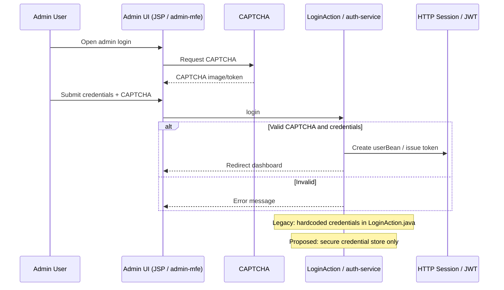
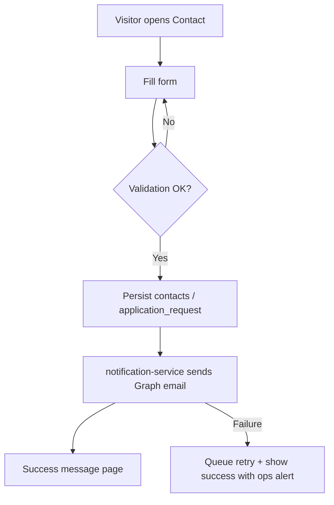
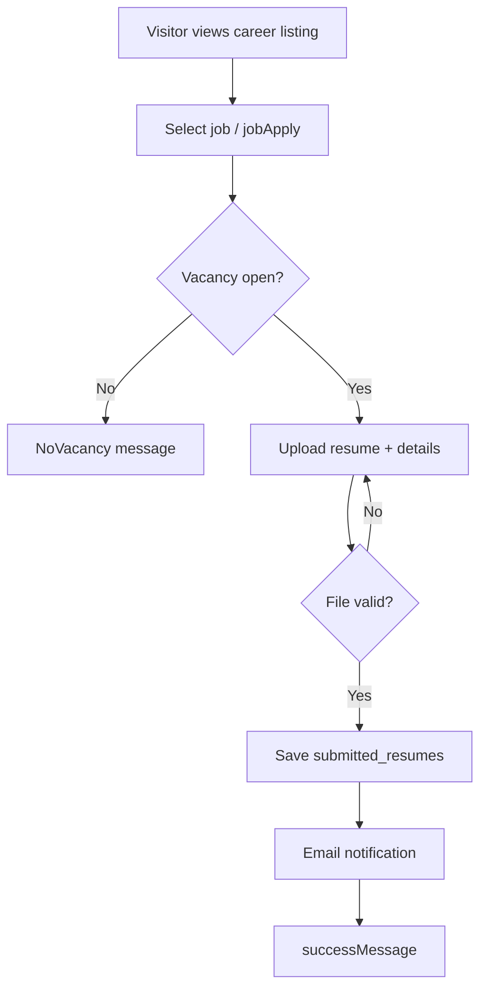
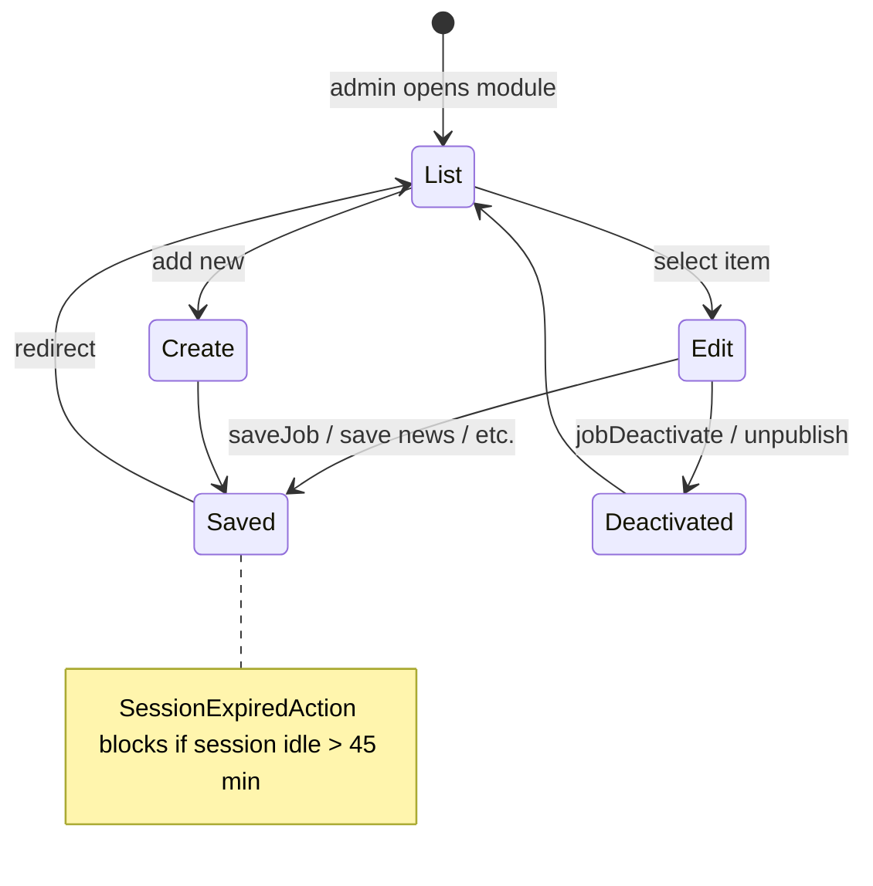
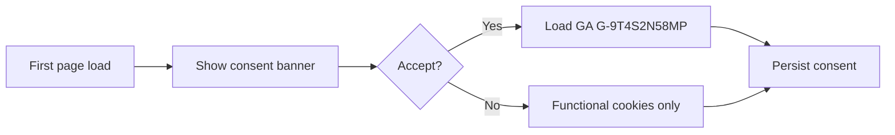

# Business Workflows

**Date:** 2026-11-04

## 1. Admin authentication (existing vs proposed)

## 2. Public enquiry submission

## 3. Job application

## 4. Admin CRUD (generic content)

## 5. Cookie consent and analytics

