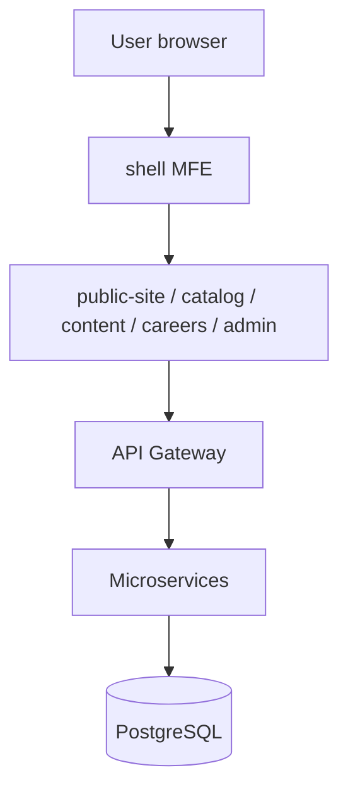

# Future-State Application Architecture — Unified Enterprise Website

**Date:** 2026-11-04

## 1. Vision

One **unified KRAN Consulting website** for visitors and administrators: single shell, single sign-on experience, consistent design system, and seamless navigation between marketing content and the admin CMS—while internally composed of **React micro frontends** and **Spring Boot microservices** on **PostgreSQL**.

Users must not perceive disjoint applications when moving from public pages to `/admin`.

## 2. Unified experience layer

| Element | Implementation |
|---------|----------------|
| Application shell | `shell` MFE — routing, layout, auth gate, module federation host |
| Design system | Shared component library (tokens, typography, buttons, tables, forms) |
| Navigation | Top nav (public) + contextual admin sidebar (admin zone) |
| Notifications | Global toast + notification drawer (future) |
| Profile | Unified admin profile menu (future) |
| Errors | Global error boundary + RFC 7807 API errors |

## 3. Micro frontend map (same as SRS)

| MFE | User-visible scope |
|-----|-------------------|
| shell | Host, auth, layout |
| public-site | Home, about, contact, CSR, team |
| catalog-mfe | Services, solutions, projects, clients, domain |
| content-mfe | News, data sheets, gallery, timeline, banners (public) |
| careers-mfe | Careers and applications (public) |
| admin-mfe | Entire CMS (SideMenu parity) |

## 4. Backend alignment

API Gateway → domain services (auth, content, catalog, media, careers, engagement, notification) → **PostgreSQL per service**.

## 5. Gap closure mapping

| Gap theme | Architecture response |
|-----------|----------------------|
| GAP-024 Unified shell | shell MFE + shared layout |
| GAP-001/002 Auth | auth-service + admin_user in PostgreSQL |
| GAP-016/017 JSP content | Headless content APIs + MFE templates |
| GAP-019 Database | PostgreSQL migration |

## 6. Deployment view

Independent CI/CD per MFE and microservice; shell consumes versioned remoteEntry URLs; feature flags for phased module rollout.

