# KranConsulting Website Rebuild — Software Requirements Specification (MASTER)

**Version:** 1.0 | **Date:** 2026-11-04

---

# Document Control

## Document Metadata

| Field | Value |
|-------|-------|
| Project Name | KranConsulting Website |
| Document Title | KranConsulting Website – Software Requirements Specification (SRS) |
| Document Type | Software Requirements Specification |
| Document Version | 1.0 |
| Prepared For | KranConsulting |
| Prepared By | Karunakaran S |
| Document Status | Draft for Review |
| Date | 2026-11-04 |

## Revision History

| Version | Date | Author | Description |
|---------|------|--------|-------------|
| 1.0 | 2026-11-04 | Karunakaran S | Initial draft SRS — website rebuild, gap analysis, PostgreSQL architecture |

## Approvals

| Role | Name | Signature | Date |
|------|------|-----------|------|
| Product Owner | | | |
| Technical Lead | | | |
| QA Lead | | | |

## Scope

This SRS covers functional and non-functional requirements to rebuild the KranConsulting public website and admin CMS from the legacy Struts monolith to React MFEs and Spring Boot microservices with **PostgreSQL** as the target database (migrated from legacy MariaDB `kran_website`).

---

# Introduction and Purpose

## Purpose

This Software Requirements Specification defines a **complete future-state unified enterprise website** for KRAN Consulting: preserving all discoverable legacy business capabilities, documenting gaps and improvements, and specifying a React micro-frontend and Spring Boot microservices architecture on **PostgreSQL**.

## Scope

In scope: full public marketing and admin CMS functional parity; functionality gap analysis; enterprise enhancement evaluation; unified UX shell; PostgreSQL architecture; MariaDB-to-PostgreSQL migration; API inventory; traceability; Microsoft Graph email; Google Analytics with consent. Out of scope: implementation code changes to the existing WAR during SRS preparation.

## Stakeholders

| Stakeholder | Interest |
|-------------|----------|
| KRAN Marketing / BD | Public content, enquiries, SEO |
| HR | Careers and applications |
| IT Operations | Deployment, security, monitoring |
| Development team | MFE and microservice delivery |

## User classes

| Class | Description |
|-------|-------------|
| Public visitor | Anonymous browsing and form submission |
| Job seeker | Career pages and resume upload |
| Administrator | Single-role CMS operator (existing); RBAC expansion proposed |

## Assumptions and constraints

- Existing `kran_website` schema remains initial data source.
- No development on legacy WAR until SRS approval.
- Hardcoded admin credentials must not be carried forward.

---

# Future-State Application Architecture

**Date:** 2026-11-04

## 1. Vision

One **unified KRAN Consulting website** for visitors and administrators: single shell, single sign-on experience, consistent design system, and seamless navigation between marketing content and the admin CMS—while internally composed of **React micro frontends** and **Spring Boot microservices** on **PostgreSQL**.

Users must not perceive disjoint applications when moving from public pages to `/admin`.

## 2. Unified experience layer

| Element | Implementation |
|---------|----------------|
| Application shell | `shell` MFE — routing, layout, auth gate, module federation host |
| Design system | Shared component library (tokens, typography, buttons, tables, forms) |
| Navigation | Top nav (public) + contextual admin sidebar (admin zone) |
| Notifications | Global toast + notification drawer (future) |
| Profile | Unified admin profile menu (future) |
| Errors | Global error boundary + RFC 7807 API errors |

## 3. Micro frontend map (same as SRS)

| MFE | User-visible scope |
|-----|-------------------|
| shell | Host, auth, layout |
| public-site | Home, about, contact, CSR, team |
| catalog-mfe | Services, solutions, projects, clients, domain |
| content-mfe | News, data sheets, gallery, timeline, banners (public) |
| careers-mfe | Careers and applications (public) |
| admin-mfe | Entire CMS (SideMenu parity) |

## 4. Backend alignment

API Gateway → domain services (auth, content, catalog, media, careers, engagement, notification) → **PostgreSQL per service**.

## 5. Gap closure mapping

| Gap theme | Architecture response |
|-----------|----------------------|
| GAP-024 Unified shell | shell MFE + shared layout |
| GAP-001/002 Auth | auth-service + admin_user in PostgreSQL |
| GAP-016/017 JSP content | Headless content APIs + MFE templates |
| GAP-019 Database | PostgreSQL migration |

## 6. Deployment view

Independent CI/CD per MFE and microservice; shell consumes versioned remoteEntry URLs; feature flags for phased module rollout.

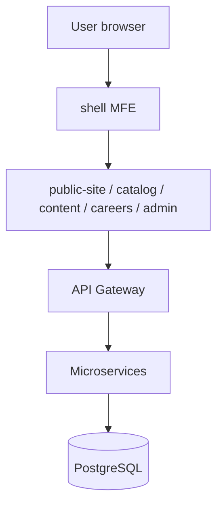

---

# Existing System Analysis

**Document status:** Generated from embedded reverse-engineering notes (not runtime analysis).  
**Scope:** As-is system supporting public marketing site and single-admin CMS.  
**Date:** 2026-11-04

## 1. Executive Summary

The KranConsulting website is a monolithic Java web application delivered as a Maven WAR. It combines Apache Struts 2 actions, Spring-managed services, Hibernate ORM, and JSP/Tiles views over a MariaDB database (`kran_website`). The site publishes company services, product/solution portfolios, case studies, news, blogs (labeled “Data Sheets” in admin), galleries, careers, and enquiry forms. A separate Struts package exposes authenticated admin CRUD for all dynamic content. Integrations include Microsoft Graph for outbound email, Google Analytics (property `G-9T4S2N58MP`) gated by cookie consent, and ESAPI-based XSS filtering.

The rebuild target replaces this stack with a React micro-frontend shell (Module Federation recommended) and Spring Boot microservices while preserving functional parity and remediating known security debt (hardcoded admin credentials).

## 2. Technology Stack (As-Is)

| Layer | Technology |
|-------|------------|
| Runtime | Java 11 Maven WAR |
| Web framework | Apache Struts 2.5.17 |
| DI / integration | Spring Framework 4.3.13 |
| Persistence | Hibernate 4.3.11 |
| Database | MariaDB schema `kran_website` |
| Presentation | JSP, Bootstrap, jQuery, Apache Tiles |
| Internal framework | kran-framework ES2-1.1 |
| Input sanitization | ESAPI XSS filter |
| Email | Microsoft Graph |
| Analytics | Google Analytics G-9T4S2N58MP with cookie consent |

## 3. Application Entry and Routing

- **Primary entry:** Struts `welcome → yCIMVQ5RMbA.jsp`.
- **Static welcome file:** `yCIMVQ5RMbA.html` (served when configured as welcome-file).
- **View composition:** Apache Tiles layouts wrap JSP fragments; Bootstrap and jQuery provide client behavior.

Public URLs map to Struts `.action` endpoints in the **login** package (naming reflects historical packaging, not unauthenticated-only scope). Admin URLs map to the **session** package and require an HTTP session carrying `userBean`.

## 4. Authentication and Session Model

| Aspect | Detail |
|--------|--------|
| Identity model | Single administrative operator |
| Login flow | `LoginAction.login` with `CaptchaInner` validation |
| Credential storage | Hardcoded in LoginAction.java; requires migration to secure credential store (password not documented). |
| Session attribute | `userBean` |
| Session guard | `SessionExpiredAction` interceptor |
| Timeout | 45 minutes |

**Security finding (document only):** Administrative authentication relies on hardcoded credentials in source. Rebuild must externalize secrets (vault, environment, or identity provider) and eliminate password material from the repository.

## 5. Public Struts Actions (login package)

The following capabilities are exposed without admin session (some accept POST submissions):

- welcome
- aboutus
- contact
- sendMsg
- getService
- solutions (?val= slug)
- projects
- readProject
- projectDetail
- kranprojects
- allsolutions
- domain
- clients
- casestudy/casestudies
- readCase
- categorycase
- datasheets (public blog)
- blog
- readBlog
- news
- newsDetail
- viewNews
- gallery
- galleryAjax
- galleryView
- career
- overview
- jobApply
- saveCandidate
- submitCareerForm
- submitEnquiry
- submitKProjects
- submitKSolutions
- enquire
- search/result
- teammanagement
- krancsr
- krantech
- timeline
- viewBanner
- viewTestimonial
- cookie consent actions
- captcha
- comingsoon
- successMessage

### 5.1 Services (`getService`)

Query parameter `val` selects one of:

- consultancy
- software-development
- mobile-app-development
- project-product-implementation
- maintenance-support
- porting-migration

### 5.2 Solutions (`solutions`)

Query parameter `val` selects solution detail slugs rendered via `Solutions.jsp`, including:

- probity-financials
- audit-management-system
- sirius
- charitable-endowments-platform
- comprehensive-loan-management-system
- project-monitoring-information-system
- report-monitoring-information-system
- inspection-management-system
- phoenix
- centralized-welfare-management-system
- stage
- integrated-human-resource-management-system
- financial-accounting-system
- budget-expenditure-monitoring-system
- smartNet
- general-administration-management-system
- fund-benefits-management-system
- smart-office
- saarathi
- galaxy
- application-lifecycle-management-solution
- galaxy-med
- training-administration-management-solution
- e-metier
- online-platform-logistics-management
- order-payment-processing-solution
- advertisement-management-information-repository
- digital-platform-clinical-trials-registry
- vtcres
- pfms360
- hrms
- kranps
- kranss

Additional mobile variants and combined listing actions (`allsolutions`, `kranprojects`, etc.) exist as documented in Struts configuration.

## 6. Admin Struts Actions (session package)

Authenticated admin capabilities include:

- dashboard
- sidemenu
- request
- solRequest
- adminCareer
- careerAdd
- saveJob
- editJob
- jobDeactivate
- NoVacancy
- jobApplications
- downloadDoc
- downloadDocu
- downloadFilteredResumes
- adminNews CRUD
- adminGallery groups/images
- adminKranProjects
- adminKranSolutions
- adminKranSeniors
- adminKranFaces
- adminKranTimeline CRUD
- getProjectProduct CRUD
- adminBanner
- adminBlogs (Data Sheets)
- adminCase
- mailSetup
- categorySetup
- solRequest

Notable behaviors:

- **Careers:** Job CRUD, vacancy toggle (`NoVacancy`), application review, resume download (single and filtered bulk).
- **Content:** News, gallery (groups + images), banners, blogs/data sheets, case studies, categories.
- **Kran-specific catalogs:** Projects, solutions, senior leadership, faces, timeline entries.
- **Operational:** Contact/application requests, solution requests (`solRequest`), mail setup.

## 7. Page and Function Inventory

The table below maps observed modules to Struts actions, primary JSP views, roles, and rebuild priority. Static/marketing sections without dedicated Hibernate entities are noted as **content-in-JSP** (Requires Business Confirmation for CMS migration scope).

| Module | Page / Route (legacy) | Primary JSP / View | Functionality | User Role | Priority |
|--------|------------------------|-------------------|---------------|-----------|----------|
| Home | `welcome.action` | yCIMVQ5RMbA.jsp | Home, banners, testimonials | Public | High |
| About | `aboutus.action` | AboutUs.jsp | Company overview, anchors (quality, culture, awards, leadership, timeline, FAQ) | Public | High |
| Services | `getService?val=` | Service.jsp | Six service offering pages | Public | High |
| Solutions catalog | `allsolutions`, `solutions?val=` | AllSolutions.jsp, Solutions.jsp | Solution listing and ~30 product detail slugs | Public | High |
| Projects | `projects`, `readProject`, `projectDetail` | AllKranProjects.jsp, ReadProjects.jsp, ProjectDetail.jsp | Kran project portfolio | Public | High |
| Kran PS/SS | `kranps`, `kranss`, mobile variants | Kranps.jsp, KranSolutions.jsp, Mobile*.jsp | Legacy product/solution landing pages | Public | Medium |
| Domain | `domain.action` | Domain.jsp | Domain consulting | Public | Medium |
| Clients | `clients.action` | Clients-Kran.jsp | Client showcase | Public | Medium |
| Case studies | `casestudy`, `readCase`, `categorycase` | Case.jsp, CaseDetails.jsp, CategoryCase.jsp | Filterable case studies | Public | High |
| Data sheets | `datasheets`, `blog`, `readBlog` | DataSheets.jsp, Blog.jsp, BlogDetails.jsp | Blog entity; admin label "Data Sheets" | Public | High |
| News | `news`, `newsDetail`, `viewNews` | AllNews.jsp, NewsDetail.jsp, News.jsp | News and events | Public | High |
| Gallery | `gallery`, `galleryAjax`, `galleryView` | Gallery.jsp, GalleryAjax.jsp, GalleryView.jsp | Photo galleries by group | Public | Medium |
| Careers | `overview`, `career`, `jobApply` | CareerOverview.jsp, Career.jsp, JobApply.jsp | Jobs and applications | Public | High |
| Team | `teammanagement.action` | TeamManagement.jsp | Faces of KRAN / team | Public | Medium |
| CSR | `krancsr.action` | KranCsr.jsp | CSR initiatives | Public | Medium |
| Technologies | `krantech.action` | KranTechnologies.jsp | Technology stack showcase | Public | Low |
| Contact | `contact.action` | ContactUs.jsp | Contact form | Public | High |
| Enquiry | `enquire`, `submitEnquiry`, `submitKProjects`, `submitKSolutions` | Enquiry.jsp, ajax Result.jsp | Product/project/solution enquiries | Public | High |
| Search | `search`, `result` | SearchResult.jsp | Site search | Public | Medium |
| PFMS / HRMS | `pfms360`, `hrms` | Pfms.jsp, Hrms.jsp | Dedicated solution landing pages | Public | Medium |
| Admin login | `admin`, `login` | AdminLogin.jsp | Admin authentication | Admin | High |
| Admin dashboard | `dashboard.action` | Dashboard.jsp | Admin home | Admin | High |
| Admin enquiries | `request`, `solRequest` | Request.jsp, SolRequest.jsp | Review contact/solution requests | Admin | High |
| Admin careers | `adminCareer`, `jobApplications`, etc. | AdminCareer*.jsp, JobApplications.jsp | Job CRUD and applications | Admin | High |
| Admin content | `adminNews`, `adminBlogs`, `adminCase`, `adminBanner`, `adminGallery` | Admin*.jsp | CMS for news, data sheets, cases, banners, gallery | Admin | High |
| Admin Kran catalogs | `adminKranProjects`, `adminKranSolutions`, `adminKranSeniors`, `adminKranFaces`, `adminKranTimeline` | Admin*.jsp | Portfolio and people content | Admin | High |
| Admin config | `mailSetup`, `categorySetup`, `getProjectProduct` | MailSetup.jsp, CategorySetup.jsp, ProjectProduct.jsp | Mail routing, categories, legacy product catalog | Admin | Medium |
| System | `sessionexpired`, `error`, `PageNotFound` | sessionexpired.jsp, error.jsp | Error and session handling | All | High |

## 8. Data Model (Hibernate Entities)

Nineteen mapped entities align to MariaDB tables:

- contacts
- careers
- news
- application_request
- gallery
- gallgroup
- project_product
- banner
- blog
- comments
- mail_setup
- category
- submitted_resumes
- casestudy
- kran_faces
- kran_seniors
- kran_projects
- kran_solutions
- kran_timeline

Relationships are primarily foreign keys managed in Hibernate mappings and admin UI workflows (e.g., gallery images → `gallgroup`, blog comments → `blog`, resumes → `careers`).

## 9. Cross-Cutting Concerns

### 9.1 Email

Outbound messages (enquiries, career notifications, admin-triggered mail) use **Microsoft Graph** configuration stored in `mail_setup`.

### 9.2 Analytics and consent

Google Analytics tag `G-9T4S2N58MP` loads only after cookie consent actions record user preference.

### 9.3 Security controls

- ESAPI XSS filter sanitizes request data.
- CAPTCHA protects login and selected public forms.
- Session expiration redirects unauthenticated admin access.

### 9.4 Known limitations driving rebuild

- Monolithic deployment and coupled UI (JSP) hinder independent release of marketing vs admin features.
- Struts 2.5 / Spring 4 / Hibernate 4 stack is end-of-life relative to current support policies.
- Hardcoded admin credentials and single-user model limit operational security.
- No first-class REST API; mobile and future channels cannot consume content without HTML scraping.

## 10. Rebuild Implications

| Existing artifact | Rebuild direction |
|-------------------|-------------------|
| Struts `.action` URLs | Versioned REST APIs + SPA routes |
| JSP/Tiles | React MFEs with shared design system |
| Hibernate monolith | Service-owned schemas or shared DB with bounded contexts |
| Session `userBean` | JWT or server-side session via auth-service |
| `mail_setup` table | notification-service + secure config store |

## 11. Glossary

- **Data Sheets:** Admin label for `blog` entity content exposed publicly as datasheets/blog.
- **Kran catalog entities:** `kran_projects`, `kran_solutions`, `kran_faces`, `kran_seniors`, `kran_timeline` power differentiated site sections.
- **MFE:** Micro-frontend; independently deployable UI bundle integrated via Module Federation.

---

# Complete Application Sitemap

**Date:** 2026-11-04  
**Entry:** `welcome.action` / `yCIMVQ5RMbA.html`  
**Admin entry:** `admin.action` → `login.action` → `dashboard.action`

## 1. Site tree

```
KranConsulting (unified future shell)
├── Public (public-site + catalog-mfe + content-mfe + careers-mfe)
│   ├── Home (welcome)
│   ├── About (aboutus + anchors: quality, culture, awards, leadership, timeline, FAQ, …)
│   ├── Services (getService?val=*)
│   │   ├── consultancy
│   │   ├── software-development
│   │   ├── mobile-app-development
│   │   ├── project-product-implementation
│   │   ├── maintenance-support
│   │   └── porting-migration
│   ├── Solutions (allsolutions, solutions?val=<slug>)
│   ├── Projects (projects, readProject, projectDetail, kranps, kranss, mobile*)
│   ├── Domain (domain)
│   ├── Clients (clients)
│   ├── Case studies (casestudy, readCase, categorycase)
│   ├── Data sheets (datasheets, blog, readBlog)
│   ├── News (news, newsDetail, viewNews, viewNewsDesc)
│   ├── Gallery (gallery, galleryView, galleryAjax)
│   ├── Careers (overview, career, jobApply, jobOverview, successMessage)
│   ├── Team (teammanagement)
│   ├── CSR (krancsr)
│   ├── Technologies (krantech)
│   ├── Contact (contact)
│   ├── Enquiry flows (enquire, submitEnquiry, submitKProjects, submitKSolutions)
│   ├── Product landings (pfms360, hrms, …)
│   ├── Search (search, result)
│   └── Cookie consent (AJAX save/get)
└── Admin (admin-mfe, session required)
    ├── Dashboard (dashboard)
    ├── Requests (request, solRequest)
    ├── Careers (adminCareer, careerAdd, editJob, jobDeactivate, NoVacancy, jobApplications)
    ├── News (adminNews, newsAdd, editNews, newsDeactivate, readNews)
    ├── Data sheets (adminBlogs, blogAdd, editBlog, blogDeactivate, downloadBlogDoc)
    ├── Case studies (adminCase, caseAdd, editCase, caseDeactivate, downloadCaseDoc)
    ├── Gallery (adminGallery, groupAdd, groupView, galleryAdd, deleteImage, deactivateGroup)
    ├── Solutions portfolio (adminKranSolutions + add/edit/deactivate)
    ├── Timeline (adminKranTimeline + add/edit/deactivate)
    ├── Projects portfolio (adminKranProjects + add/edit/deactivate)
    ├── Product/Projects (getProjectProduct, ppAdd, editPP, deactivatePP, updateOrder)
    ├── Seniors (adminKranSeniors + CRUD/deactivate)
    ├── Faces (adminKranFaces + CRUD/deactivate)
    ├── Banners (adminBanner + CRUD/deactivate, updateBannerOrder)
    ├── Mail setup (mailSetup, mailAdd, editMail, mailDeactivate)
    └── Categories (categorySetup, categoryAdd, editCategory, categoryDeactivate)
```

## 2. Page registry (representative)

| Page ID | Page name | Module | Purpose | Roles | Struts action | MFE (proposed) |
|---------|-----------|--------|---------|-------|---------------|----------------|
| PG-001 | Dashboard | Admin CMS | View admin home, banner order widget | Admin | dashboard | admin-mfe |
| PG-002 | General requests | Admin CMS | List contacts type G | Admin | request | admin-mfe |
| PG-003 | Solution requests | Admin CMS | List all enquiry types | Admin | solRequest | admin-mfe |
| PG-004 | Careers | Admin CMS | Job CRUD | Admin | adminCareer | admin-mfe |
| PG-005 | No vacancy | Admin CMS | Global hiring message | Admin | NoVacancy | admin-mfe |
| PG-006 | Job applications | Admin CMS | Review applications, download resumes | Admin | jobApplications | admin-mfe |
| PG-007 | News/Events | Admin CMS | News CRUD, deactivate | Admin | adminNews | admin-mfe |
| PG-008 | Data sheets | Admin CMS | Blog entity CRUD (admin label Data Sheets) | Admin | adminBlogs | admin-mfe |
| PG-009 | Case studies | Admin CMS | Case study CRUD | Admin | adminCase | admin-mfe |
| PG-010 | Gallery | Admin CMS | Groups + images | Admin | adminGallery | admin-mfe |
| PG-011 | Kran solutions | Admin CMS | Portfolio solutions CRUD | Admin | adminKranSolutions | admin-mfe |
| PG-012 | Timeline | Admin CMS | Timeline CRUD | Admin | adminKranTimeline | admin-mfe |
| PG-013 | Kran projects | Admin CMS | Portfolio projects CRUD | Admin | adminKranProjects | admin-mfe |
| PG-014 | Product/Projects catalog | Admin CMS | project_product CRUD | Admin | getProjectProduct | admin-mfe |
| PG-015 | Kran seniors | Admin CMS | Senior profiles CRUD | Admin | adminKranSeniors | admin-mfe |
| PG-016 | Kran faces | Admin CMS | Faces CRUD | Admin | adminKranFaces | admin-mfe |
| PG-017 | Banners | Admin CMS | Banner CRUD, drag order | Admin | adminBanner | admin-mfe |
| PG-018 | Mail setup | Admin CMS | Routing emails by type | Admin | mailSetup | admin-mfe |
| PG-019 | Categories | Admin CMS | Category reference CRUD | Admin | categorySetup | admin-mfe |
| PG-020 | Home | Public | Landing, banners, testimonials | Public | welcome | public-site/catalog/content/careers |
| PG-021 | About | Public | Corporate about anchors | Public | aboutus | public-site/catalog/content/careers |
| PG-022 | Services | Public | Six service pages via val | Public | getService | public-site/catalog/content/careers |
| PG-023 | Solutions | Public | Product solution catalog | Public | solutions, allsolutions | public-site/catalog/content/careers |
| PG-024 | Projects | Public | Kran projects public | Public | projects, readProject, projectDetail | public-site/catalog/content/careers |
| PG-025 | Case studies | Public | Case listing/detail | Public | casestudy, readCase, categorycase | public-site/catalog/content/careers |
| PG-026 | Data sheets | Public | Blog/data sheets | Public | datasheets, blog, readBlog | public-site/catalog/content/careers |
| PG-027 | News | Public | News listing/detail | Public | news, newsDetail, viewNews | public-site/catalog/content/careers |
| PG-028 | Gallery | Public | Photo galleries | Public | gallery, galleryAjax, galleryView | public-site/catalog/content/careers |
| PG-029 | Careers | Public | Jobs and apply | Public | overview, career, jobApply | public-site/catalog/content/careers |
| PG-030 | Team | Public | Faces of KRAN | Public | teammanagement | public-site/catalog/content/careers |
| PG-031 | CSR | Public | CSR page | Public | krancsr | public-site/catalog/content/careers |
| PG-032 | Technologies | Public | Tech showcase | Public | krantech | public-site/catalog/content/careers |
| PG-033 | Contact | Public | Contact form | Public | contact, sendMsg | public-site/catalog/content/careers |
| PG-034 | Enquiries | Public | Product/project forms | Public | submitEnquiry, submitKProjects, submitKSolutions, enquire | public-site/catalog/content/careers |
| PG-035 | Search | Public | Site search | Public | search, result | public-site/catalog/content/careers |
| PG-036 | Cookie consent | Public | GA consent | Public | saveCookieConsent, getCookieConsent | public-site/catalog/content/careers |
| PG-037 | Admin login | Public | CMS login | Public | admin, login, logout | public-site/catalog/content/careers |

## 3. Orphan / weak-navigation routes (source-code observations)

| Route | Observation |
|-------|-------------|
| `comingsoon` | Under construction placeholder |
| `probity`, `snasparsh` | Commented out in login-config.xml |
| `mobilekranps`, `mobilekranss`, `mobiletech` | Parallel mobile JSPs — not in main desktop nav |
| `viewComments`, `addReply` | Blog comments — public; admin moderation link unclear |
| `product`, `krancs`, `kranprojects` (HTML) | Legacy HTML actions — verify redirects |

**Rule:** Do not remove until business confirms deprecation (Category E).

---

# Existing Functionality Gap Analysis

**Date:** 2026-11-04  
**Legacy reference:** `C:\Users\Karunakaran\git\KranConsulting` (Struts 2 + JSP + MariaDB)  
**Target:** Unified enterprise website (React MFE + Spring Boot + PostgreSQL)

## 1. Methodology

- Inventoried Struts actions in `login-config.xml` (172 actions) and admin `SideMenu.jsp`.
- Mapped public header navigation in `Header.jsp`.
- Verified Hibernate entities (19 tables); no Redux/React in legacy (N/A).
- CRUD/applicability matrix per module; approval workflows **not found** in source.

## 2. Requirement classification

| Code | Meaning |
|------|---------|
| **A** | Existing functionality — must preserve |
| **B** | Existing functionality — must improve |
| **C** | Missing functionality — recommended addition |
| **D** | New enterprise functionality — future system |
| **E** | Requires business confirmation |

## 3. Gap register

| Gap ID | Module | Existing | Limitation / missing | Business impact | Recommended enhancement | Proposed FR | Priority | Implementation | Biz confirm |
|--------|--------|----------|----------------------|-----------------|-------------------------|-------------|----------|----------------|-------------|
| GAP-001 | Authentication | Single hardcoded admin user in LoginAction | No DB user management, no password reset, no MFA | High security and ops risk | auth-service with admin_user, vault credentials, optional MFA | FR-002, FR-AUTH-* (proposed) | High | auth-service + admin-mfe | Yes |
| GAP-002 | Authorization | Single session userBean; no roles | No RBAC, no module-level permissions | Cannot delegate CMS duties safely | Role/permission matrix; JWT claims | FR-USER-* (proposed) | High | auth-service | Yes |
| GAP-003 | CMS content | Immediate publish on save | No draft/review/publish workflow | Content errors go live instantly | Draft status + publish schedule (news already has publish_Date) | FR-CMS-DRAFT (proposed) | Medium | content-service | Yes |
| GAP-004 | CMS lifecycle | Deactivate pattern; limited hard delete | Inconsistent delete vs deactivate; gallery deleteImage only | Orphan media risk | Unified soft-delete + media GC job | DB-REQ-004 | Medium | all CMS services | No |
| GAP-005 | Approvals | Not present in legacy | No approval/reject/resubmit for any module | N/A for current CMS; needed if compliance required | Defer unless business mandates editorial approval | — | Low | — | Yes |
| GAP-006 | Dashboard | Dashboard.jsp minimal | No analytics cards, pending counts, activity feed | Admin lacks operational overview | Admin dashboard widgets per module counts | FR-ADM-DASH (proposed) | Medium | admin-service BFF | Yes |
| GAP-007 | Notifications | Email via Graph only | No in-app notification center | Admin must use email for all alerts | notification-service inbox + email | FR-NOT-* (proposed) | Medium | notification-service | Yes |
| GAP-008 | Audit | No content audit trail in DB | Cannot see who changed news/banner | Compliance and troubleshooting gap | Audit columns + audit_log table | NFR-SEC-008, PostgreSQL audit | High | each service | No |
| GAP-009 | Search | Basic search action | No advanced search/facets across modules | Poor discoverability on large content | PostgreSQL FTS or OpenSearch | OQ-005 | Medium | content-service | Yes |
| GAP-010 | Comments | saveComment on blogs | Moderation UI not verified in admin SideMenu | Spam/toxic comment risk | Admin comment moderation module | FR-ENG-COMMENT (proposed) | Medium | engagement-service | Yes |
| GAP-011 | Reports | No operational reports | No Excel/PDF exports except resume bulk download | HR/marketing reporting manual | Report export APIs for enquiries/applications | FR-REP-* (proposed) | Medium | engagement/careers | Yes |
| GAP-012 | User profile | Not present | No admin profile/password change UI | Password rotation difficult | Profile + change password in admin-mfe | FR-USER-PROFILE (proposed) | Medium | auth-service | No |
| GAP-013 | Forgot password | Not present | No self-service recovery | Lockout requires developer | Email-based reset flow | FR-AUTH-RESET (proposed) | Medium | auth-service | Yes |
| GAP-014 | Multi-admin | Not present | Only one logical operator | Bus factor and concurrency | Multiple admin_user records | FR-USER-001 (proposed) | High | auth-service | Yes |
| GAP-015 | Mobile JSP variants | mobilekranps, mobiletech, mobilekranss | Separate mobile pages vs responsive | Duplicate maintenance | Responsive MFE; retire mobile routes | NFR-UX-003 | Medium | catalog-mfe | Yes |
| GAP-016 | Solution pages | Large Solutions.jsp static branches | Content in JSP not CMS-driven | Marketing updates require deploy | CMS-driven solution pages or headless content | FR-CAT-SOL-CMS (proposed) | High | catalog-mfe | Yes |
| GAP-017 | Service pages | Service.jsp session.tab branches | Same as solutions — JSP-heavy | Slow content iteration | Structured content API + MFE templates | FR-CAT-SVC-CMS (proposed) | Medium | catalog-mfe | Yes |
| GAP-018 | API layer | Struts .action only | No REST for integrations | Cannot feed mobile/apps | REST API inventory (proposed) | API Requirements | High | api-gateway | No |
| GAP-019 | Database | MariaDB monolith | Not PostgreSQL; no service isolation | Blocks scalable microservices | PostgreSQL per service + migration | Database_Requirements.md | High | all services | No |
| GAP-020 | Captcha | Session Captcha/CaptchaInner | No modern bot protection option | Abuse on forms | reCAPTCHA/hCaptcha + rate limits | OQ-012 | Medium | engagement-service | Yes |
| GAP-021 | Job applications | downloadFilteredResumes | Filter UI capabilities require UI verification | HR bulk processing | Preserve + improve filter/export in admin-mfe | FR-005 | High | careers-service | No |
| GAP-022 | Mail setup | mail_setup table | Secrets in Graph code defaults observed | Credential leakage risk | Vault + notification-service | NFR-SEC-002 | High | notification-service | No |
| GAP-023 | Category | String category on blog/case | Weak FK to category table | Inconsistent taxonomy | Normalize category_id FK in PostgreSQL | catalog-service | Medium | catalog-service | No |
| GAP-024 | Global admin shell | Separate JSP admin layout | Different UX from public site | Disjoint experience | Unified shell MFE with admin zone | Future_State doc | High | shell | No |
| GAP-025 | Under construction | comingsoon action | Placeholder routes exist | Document or redirect | 404 or CMS redirect rules | FR-PUB-UC | Low | shell | Yes |

## 4. Preservation summary (Category A — sample)

All public modules (home, about, services, solutions, projects, case studies, data sheets, news, gallery, careers, contact, enquiries, search) and admin CMS modules listed in `SideMenu.jsp` **must reach functional parity** in the new system.

See `Complete_Application_Sitemap.md` and `Functional_Requirements.md` (FR-001–FR-080).

## 5. Non-applicable enterprise patterns (legacy)

The following were **not identified** in the existing application (do not assume they exist):

- Multi-level approval workflows, delegation, escalation
- Draft/submit/approve/reject for CMS content
- Organization/department master data
- In-application notification center
- Role management UI
- Scheduled operational reports

These appear in `Enterprise_Functionality_Recommendations.md` as evaluated additions.

---

# Module-Wise Workflow Analysis

**Date:** 2026-11-04

## 1. Workflow completeness matrix

Legend: C=Create R=Read U=Update D=Deactivate/Del S=Submit X=export. **Approve/Reject/Cancel/Reopen/Draft** — not applicable in legacy CMS unless noted as gap.

| Module | Open | List/Read | Search/Filter | Create | Edit | Delete/Deactivate | Submit | Approve | Export | Notify | Audit | Completeness notes |
|--------|------|-----------|---------------|--------|------|-------------------|--------|---------|--------|--------|-------|---------------------|
| Public contact | Y | — | — | Y form | — | — | Y sendMsg | — | — | Y email | — | CAPTCHA validated |
| Job apply | Y | Y jobs | — | Y apply | — | — | Y saveCandidate | — | — | Y email | — | Resume upload |
| Admin news | Y | Y adminNews | partial table | Y newsAdd | Y editNews | Y newsDeactivate | Y save | — | — | — | — | No draft workflow (GAP-003) |
| Admin careers | Y | Y adminCareer | — | Y careerAdd | Y editJob | Y jobDeactivate | Y saveJob | — | Y resumes | — | — | jobApplications review |
| Admin gallery | Y | Y groupView | — | Y groupAdd/galleryAdd | — | Y deleteImage/deactivateGroup | Y save | — | — | — | — | |
| Admin banner | Y | Y adminBanner | — | Y bannerAdd | Y editBanner | Y bannerDeactivate | Y save | — | — | — | — | Drag order updateBannerOrder |
| Admin data sheets | Y | Y adminBlogs | — | Y blogAdd | Y editBlog | Y blogDeactivate | Y save | — | Y downloadBlogDoc | — | — | |
| Admin requests | Y | Y request/solRequest | — | — | — | — | — | — | — | — | — | Read-only lists |
| Blog comments | — | Y viewComments | — | Y saveComment | — | — | — | — | — | — | — | Moderation gap GAP-010 |
| Authentication | Y | — | — | — | — | — | Y login | — | — | — | — | Single admin GAP-001 |

## 2. End-to-end workflow — job application (existing)

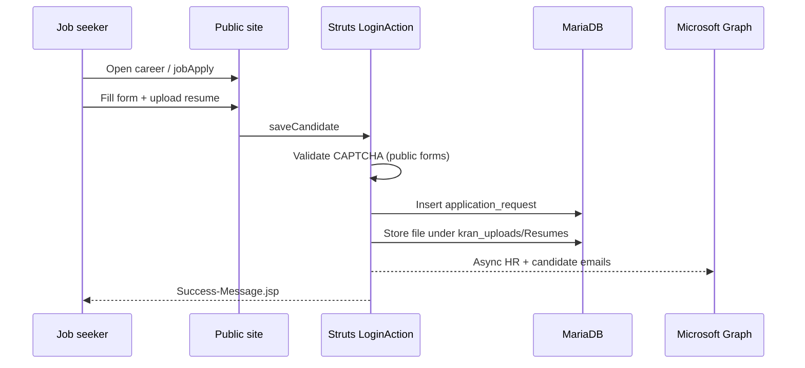

## 3. End-to-end workflow — admin news publish (existing)

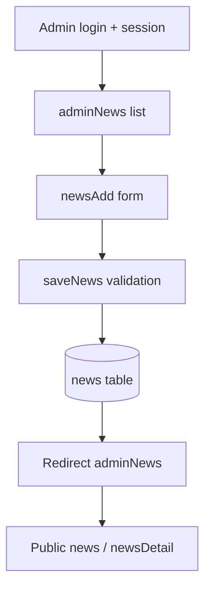

## 4. Target-state workflow enhancements (proposed — Category C/D)

- Editorial draft → review → publish for news and data sheets.
- Admin MFA login; role-based module access.
- In-app notification when new enquiry or job application arrives.

---

# Enterprise Functionality Recommendations

**Date:** 2026-11-04

| Area | Recommendation | Rationale |
|------|----------------|-----------|
| A. Centralized application management | **Include** | Shell MFE with module registry, unified nav, global error boundary — **required** for unified UX (Section 7). |
| B. Authentication and security | **Partial + extend** | Preserve login+CAPTCHA+session (A). Add forgot password, MFA, lockout, JWT (C/D). **Remove hardcoded credentials (B).** |
| C. User and organization management | **Defer / partial** | Legacy: single admin only. Recommend multi-admin + roles (C). Org/dept masters **not applicable** unless KRAN expands CMS to intranet (E). |
| D. Workflow and approval management | **Defer** | No legacy approval flows. Include only if editorial/legal approval mandated (E). |
| E. Dashboard and analytics | **Improve** | Legacy dashboard minimal (B). Role-based widgets + GA integration (C). |
| F. Notification management | **Improve** | Email exists (A). Add in-app inbox + templates (C). |
| G. Document management | **Improve** | File upload/download exists for resumes, images, PDFs (A). Add virus scan, object storage, versioning (C). |
| H. Search and data management | **Improve** | Site search exists (A). Advanced search, export enquiries (C). No bulk import in legacy. |
| I. Audit and activity management | **Add** | Not in legacy (C/D). PostgreSQL audit columns + audit_log. |
| J. Master data and configuration | **Preserve + improve** | categorySetup, mailSetup (A). Centralize in catalog/notification services with PostgreSQL. |
| K. Reporting and export | **Add partial** | Resume export exists (A). Enquiry/application Excel reports (C). |
| L. System administration | **Add** | Actuator health, centralized logging (D). Module toggles (E). |

## Priority for unified enterprise website

1. Unified shell + preserved public/admin features (A).
2. Security remediation + PostgreSQL (B, database docs).
3. Admin UX improvements: dashboard, notifications, audit (E, F, I).
4. Business-confirmed: approvals, org structure, scheduled reports (D, C sections — E).

---

# Business Rules Catalog

**Date:** 2026-11-04  
**Source:** Legacy `LoginAction.java`, `Contacts` entity, `SideMenu.jsp`, `web.xml`, Struts config.

| Rule ID | Domain | Rule | Source |
|---------|--------|------|--------|
| BR-AUTH-001 | Authentication | Admin login requires CaptchaInner match and valid credentials | LoginAction.login |
| BR-AUTH-002 | Session | Admin routes require session attribute `userBean` | SessionExpiredAction |
| BR-AUTH-003 | Session | HTTP session timeout 45 minutes | web.xml |
| BR-FORM-001 | Contact | sendMsg defaults request_type to `G` if empty | LoginAction.sendMsg |
| BR-FORM-002 | Contact | request_type `C` changes email subject line | LoginAction.sendMsg |
| BR-FORM-003 | Enquiry | submitEnquiry requires session Captcha match | LoginAction.submitEnquiry |
| BR-FORM-004 | Applications | Resume stored under `kran_uploads/Resumes` with random prefix filename | LoginAction.saveCandidate |
| BR-MAIL-001 | Email | Mail routing uses mail_setup rows by type (G, S, H, …); fallback to info@kran.co.in | LoginAction mail blocks |
| BR-MAIL-002 | Email | Outbound mail via Microsoft Graph async CompletableFuture | GraphEmailService |
| BR-CAR-001 | Careers | Job linked applications via career_Id FK | ApplicationRequest |
| BR-CMS-001 | CMS | Deactivate pattern used vs hard delete for most content | *Deactivate actions |
| BR-CMS-002 | Banner | Display order updated via updateBannerOrder / tableDnD | Dashboard.jsp |
| BR-UPLOAD-001 | Upload | Struts multipart max 50MB | struts.xml constant |
| BR-CONSENT-001 | Analytics | GA loads per cookie consent / consent mode v2 | Header.jsp |
| BR-SEC-001 | Security | Direct JSP access blocked via web.xml security constraint | web.xml |

## Proposed rules (target system)

| Rule ID | Rule |
|---------|------|
| BR-PG-001 | All business timestamps stored as TIMESTAMPTZ (UTC) in PostgreSQL |
| BR-PG-002 | Soft-deleted CMS rows excluded from public APIs |
| BR-RBAC-001 | Admin module access enforced via role permissions (future) |

---

# Functional Requirements

**Version:** 1.0 | **Date:** 2026-11-04

## 1. Introduction

Requirements below distinguish **Existing Implementation (Struts 2)** from **Proposed Implementation** (React MFEs + Spring Boot microservices). IDs use prefix `FR-`.

## 2. Requirement template (14 fields)

- Requirement ID
- Title
- Description
- Priority
- Stakeholder / Source
- Actor(s)
- Preconditions
- Trigger
- Main Flow
- Alternate / Exception Flows
- Data Requirements
- Existing Implementation (Struts 2)
- Proposed Implementation
- Acceptance Criteria

## 3. Detailed requirements (major features)

### FR-001: Public home page

- **Title:** Public home page
- **Description:** Visitors shall view the corporate home page with banners and testimonials consistent with current welcome flow.
- **Priority:** Must
- **Stakeholder / Source:** Marketing / Existing welcome action
- **Actor(s):** Anonymous visitor
- **Preconditions:** Site is reachable; CDN/cache configured.
- **Trigger:** User navigates to `/` or welcome route.
- **Main Flow:** System loads hero content, active banners, testimonials; records analytics only if consent granted.
- **Alternate / Exception Flows:** Missing banner data shows safe empty state; no server stack trace to client.
- **Data Requirements:** banner, kran_timeline (optional teasers)
- **Existing Implementation (Struts 2):** `welcome`, `viewBanner`, `viewTestimonial` Struts actions; JSP `yCIMVQ5RMbA.jsp`.
- **Proposed Implementation:** shell MFE route `/`; `GET /api/v1/banners/active`, `GET /api/v1/testimonials/active`; content-service.
- **Acceptance Criteria:** Lighthouse smoke pass; API p95 < 500ms for banner list; parity with legacy home sections.

### FR-002: Admin login with CAPTCHA

- **Title:** Admin login with CAPTCHA
- **Description:** Administrative users shall authenticate with username, password, and CAPTCHA before accessing CMS.
- **Priority:** Must
- **Stakeholder / Source:** Security / LoginAction
- **Actor(s):** Admin user
- **Preconditions:** Auth service available; CAPTCHA endpoint reachable.
- **Trigger:** Admin submits login form.
- **Main Flow:** Validate CAPTCHA, verify credentials from secure store, issue session/JWT, redirect to dashboard.
- **Alternate / Exception Flows:** Invalid CAPTCHA or credentials return generic error; account lockout policy TBD (see Open Questions).
- **Data Requirements:** No passwords in logs; audit login success/failure.
- **Existing Implementation (Struts 2):** `LoginAction.login`, `CaptchaInner`, session key `userBean`.
- **Proposed Implementation:** auth-service `POST /api/v1/auth/login`; CAPTCHA `GET /api/v1/auth/captcha`; admin-mfe login page.
- **Acceptance Criteria:** Pen test: no hardcoded credentials in repo; CAPTCHA required; session expires at 45 min idle.

### FR-003: Session expiration for admin

- **Title:** Session expiration for admin
- **Description:** Expired or missing admin sessions shall be rejected from admin routes.
- **Priority:** Must
- **Stakeholder / Source:** SessionExpiredAction interceptor
- **Actor(s):** Admin user, System
- **Preconditions:** Admin was previously authenticated.
- **Trigger:** Session idle exceeds 45 minutes or session invalidated.
- **Main Flow:** Interceptor/guard returns 401 or redirects to login; no partial admin data rendered.
- **Alternate / Exception Flows:** Concurrent session handling per Open Questions.
- **Data Requirements:** Session TTL configurable.
- **Existing Implementation (Struts 2):** `SessionExpiredAction`, 45-minute HTTP session.
- **Proposed Implementation:** API Gateway JWT expiry + refresh policy; auth-service session registry if server-side sessions.
- **Acceptance Criteria:** Automated test: expired token cannot call admin APIs; user prompted to re-login.

### FR-004: Contact enquiry submission

- **Title:** Contact enquiry submission
- **Description:** Visitors shall submit contact/enquiry forms that persist and trigger email notification.
- **Priority:** Must
- **Stakeholder / Source:** contact, sendMsg, submitEnquiry
- **Actor(s):** Anonymous visitor
- **Preconditions:** Form displayed; rate limits configured.
- **Trigger:** User submits valid enquiry form.
- **Main Flow:** Validate input, persist contact/application_request, enqueue email via Graph.
- **Alternate / Exception Flows:** Validation errors inline; email failure retries and surfaces ops alert without losing record.
- **Data Requirements:** contacts, application_request, mail_setup
- **Existing Implementation (Struts 2):** `contact`, `sendMsg`, `submitEnquiry`, `enquire` actions.
- **Proposed Implementation:** engagement-service `POST /api/v1/enquiries`; notification-service email dispatch.
- **Acceptance Criteria:** E2E: record in DB + email sent in staging Graph tenant.

### FR-005: Career job application

- **Title:** Career job application
- **Description:** Applicants shall view openings and submit applications with resume upload.
- **Priority:** Must
- **Stakeholder / Source:** career, jobApply, saveCandidate
- **Actor(s):** Job seeker
- **Preconditions:** Active job exists or NoVacancy disabled.
- **Trigger:** User applies from job detail page.
- **Main Flow:** Validate fields, store submitted_resumes, attach file, notify recruiters.
- **Alternate / Exception Flows:** Oversized/disallowed file types rejected; vacancy closed shows message.
- **Data Requirements:** careers, submitted_resumes
- **Existing Implementation (Struts 2):** `career`, `overview`, `jobApply`, `saveCandidate`, `submitCareerForm`.
- **Proposed Implementation:** careers-service APIs; object storage for resumes; virus scan hook (proposed).
- **Acceptance Criteria:** Resume downloadable by admin; GDPR retention policy documented.

### FR-006: News publishing (admin)

- **Title:** News publishing (admin)
- **Description:** Admin shall create, edit, publish, and retire news articles displayed on public site.
- **Priority:** Must
- **Stakeholder / Source:** adminNews CRUD
- **Actor(s):** Admin user
- **Preconditions:** Authenticated admin session.
- **Trigger:** Admin saves news item.
- **Main Flow:** Persist news record with publish flag and timestamps; invalidate public cache.
- **Alternate / Exception Flows:** Delete/archival rules per content policy.
- **Data Requirements:** news
- **Existing Implementation (Struts 2):** adminNews Struts CRUD in session package.
- **Proposed Implementation:** content-service admin APIs; public `GET /api/v1/news`.
- **Acceptance Criteria:** Published news visible within 60s cache TTL; draft not public.

### FR-007: Gallery management

- **Title:** Gallery management
- **Description:** Admin shall manage gallery groups and images; public site displays galleries and AJAX views.
- **Priority:** Must
- **Stakeholder / Source:** adminGallery, gallery, galleryAjax
- **Actor(s):** Admin, Visitor
- **Preconditions:** Media storage available.
- **Trigger:** Admin uploads image or visitor opens gallery page.
- **Main Flow:** CRUD on gallgroup/gallery; public read with pagination.
- **Alternate / Exception Flows:** Broken image URLs show placeholder.
- **Data Requirements:** gallery, gallgroup
- **Existing Implementation (Struts 2):** `gallery`, `galleryAjax`, `galleryView`, admin gallery actions.
- **Proposed Implementation:** media-service + content-service; `GET /api/v1/galleries`.
- **Acceptance Criteria:** Image upload max size enforced; EXIF stripped (proposed).

### FR-008: Solution catalog by slug

- **Title:** Solution catalog by slug
- **Description:** Visitors shall open solution detail pages for all legacy slugs under `solutions?val=`.
- **Priority:** Must
- **Stakeholder / Source:** Solutions.jsp slugs
- **Actor(s):** Anonymous visitor
- **Preconditions:** Catalog seeded with slug list.
- **Trigger:** User selects solution from menu or deep link.
- **Main Flow:** Resolve slug to catalog entry; render rich content and related assets.
- **Alternate / Exception Flows:** Unknown slug returns 404 page.
- **Data Requirements:** kran_solutions, project_product as applicable
- **Existing Implementation (Struts 2):** `solutions` action with `val` parameter; slugs in Solutions.jsp.
- **Proposed Implementation:** catalog-service `GET /api/v1/solutions/{{slug}}`; catalog-mfe route `/solutions/:slug`.
- **Acceptance Criteria:** All documented slugs resolve; redirect map for renamed slugs if any.

### FR-009: Service detail pages

- **Title:** Service detail pages
- **Description:** Visitors shall view six service offering pages via `getService` values.
- **Priority:** Must
- **Stakeholder / Source:** getService action
- **Actor(s):** Anonymous visitor
- **Preconditions:** Service definitions configured.
- **Trigger:** User navigates to service URL.
- **Main Flow:** Map `val` to content template and metadata.
- **Alternate / Exception Flows:** Invalid `val` → 404.
- **Data Requirements:** Static/content metadata
- **Existing Implementation (Struts 2):** `getService` with vals: {', '.join(SERVICE_VALS)}.
- **Proposed Implementation:** public-site MFE; `GET /api/v1/services/{{slug}}`.
- **Acceptance Criteria:** Each of six slugs renders distinct content block.

### FR-010: Cookie consent and analytics

- **Title:** Cookie consent and analytics
- **Description:** Site shall record cookie consent before loading Google Analytics `G-9T4S2N58MP`.
- **Priority:** Must
- **Stakeholder / Source:** Cookie consent actions + GA
- **Actor(s):** Anonymous visitor
- **Preconditions:** Consent banner configured.
- **Trigger:** First visit or consent change.
- **Main Flow:** Persist preference; load GA script only if accepted.
- **Alternate / Exception Flows:** Withdraw consent disables tracking and clears cookies where possible.
- **Data Requirements:** Consent audit log (proposed)
- **Existing Implementation (Struts 2):** Cookie consent Struts actions; GA tag in layout.
- **Proposed Implementation:** shell MFE consent module; `POST /api/v1/consent`; no GA until opt-in.
- **Acceptance Criteria:** Automated check: network tab shows no GA before accept.

### FR-011: Site search

- **Title:** Site search
- **Description:** Users shall search public content and view results.
- **Priority:** Should
- **Stakeholder / Source:** search/result actions
- **Actor(s):** Anonymous visitor
- **Preconditions:** Search index populated.
- **Trigger:** User submits search query.
- **Main Flow:** Query index across news, blog, solutions, projects; paginate results.
- **Alternate / Exception Flows:** Empty results page with suggestions.
- **Data Requirements:** Indexed entities: news, blog, casestudy, kran_projects, kran_solutions
- **Existing Implementation (Struts 2):** `search`, `result` Struts actions.
- **Proposed Implementation:** content-service + catalog-service search API or dedicated search index.
- **Acceptance Criteria:** Search returns relevant hits for sample queries documented in test cases.

### FR-012: Admin resume export

- **Title:** Admin resume export
- **Description:** Admin shall download individual and filtered bulk resumes.
- **Priority:** Must
- **Stakeholder / Source:** downloadDoc, downloadFilteredResumes
- **Actor(s):** Admin user
- **Preconditions:** Authenticated; applications exist.
- **Trigger:** Admin clicks download.
- **Main Flow:** Authorize admin; stream file(s) with audit log.
- **Alternate / Exception Flows:** Missing file returns 404 without path disclosure.
- **Data Requirements:** submitted_resumes binary storage
- **Existing Implementation (Struts 2):** `downloadDoc`, `downloadDocu`, `downloadFilteredResumes`.
- **Proposed Implementation:** careers-service `GET /api/v1/admin/applications/{{id}}/resume` and bulk export job.
- **Acceptance Criteria:** Download matches uploaded file hash; bulk export completes async for large sets.

## 4. Additional functional requirements (compact 14-field)

The following requirements use the same 14-field structure with concise flows.

### FR-013: About Us page

- **Title:** About Us page
- **Description:** The system shall support «About Us page» with functional parity to the legacy Struts feature.
- **Priority:** Must
- **Stakeholder / Source:** Legacy Struts action mapping
- **Actor(s):** Visitor or Admin as applicable
- **Preconditions:** Dependent services available.
- **Trigger:** User invokes feature equivalent to `aboutus`.
- **Main Flow:** Execute read or write operation; return UI or API response.
- **Alternate / Exception Flows:** Standard HTTP error handling; validation errors for writes.
- **Data Requirements:** See entity mapping in Database_Requirements.md
- **Existing Implementation (Struts 2):** Struts actions: aboutus.
- **Proposed Implementation:** Module: public-site; API: GET /api/v1/pages/about.
- **Acceptance Criteria:** Automated regression test TC-013 passes.

### FR-014: Contact page display

- **Title:** Contact page display
- **Description:** The system shall support «Contact page display» with functional parity to the legacy Struts feature.
- **Priority:** Must
- **Stakeholder / Source:** Legacy Struts action mapping
- **Actor(s):** Visitor or Admin as applicable
- **Preconditions:** Dependent services available.
- **Trigger:** User invokes feature equivalent to `contact`.
- **Main Flow:** Execute read or write operation; return UI or API response.
- **Alternate / Exception Flows:** Standard HTTP error handling; validation errors for writes.
- **Data Requirements:** See entity mapping in Database_Requirements.md
- **Existing Implementation (Struts 2):** Struts actions: contact.
- **Proposed Implementation:** Module: public-site; API: GET /api/v1/pages/contact.
- **Acceptance Criteria:** Automated regression test TC-014 passes.

### FR-015: Send message from contact

- **Title:** Send message from contact
- **Description:** The system shall support «Send message from contact» with functional parity to the legacy Struts feature.
- **Priority:** Must
- **Stakeholder / Source:** Legacy Struts action mapping
- **Actor(s):** Visitor or Admin as applicable
- **Preconditions:** Dependent services available.
- **Trigger:** User invokes feature equivalent to `sendMsg`.
- **Main Flow:** Execute read or write operation; return UI or API response.
- **Alternate / Exception Flows:** Standard HTTP error handling; validation errors for writes.
- **Data Requirements:** See entity mapping in Database_Requirements.md
- **Existing Implementation (Struts 2):** Struts actions: sendMsg.
- **Proposed Implementation:** Module: engagement-service; API: POST /api/v1/messages.
- **Acceptance Criteria:** Automated regression test TC-015 passes.

### FR-016: Projects listing

- **Title:** Projects listing
- **Description:** The system shall support «Projects listing» with functional parity to the legacy Struts feature.
- **Priority:** Must
- **Stakeholder / Source:** Legacy Struts action mapping
- **Actor(s):** Visitor or Admin as applicable
- **Preconditions:** Dependent services available.
- **Trigger:** User invokes feature equivalent to `projects, kranprojects`.
- **Main Flow:** Execute read or write operation; return UI or API response.
- **Alternate / Exception Flows:** Standard HTTP error handling; validation errors for writes.
- **Data Requirements:** See entity mapping in Database_Requirements.md
- **Existing Implementation (Struts 2):** Struts actions: projects, kranprojects.
- **Proposed Implementation:** Module: catalog-mfe; API: GET /api/v1/projects.
- **Acceptance Criteria:** Automated regression test TC-016 passes.

### FR-017: Project detail

- **Title:** Project detail
- **Description:** The system shall support «Project detail» with functional parity to the legacy Struts feature.
- **Priority:** Must
- **Stakeholder / Source:** Legacy Struts action mapping
- **Actor(s):** Visitor or Admin as applicable
- **Preconditions:** Dependent services available.
- **Trigger:** User invokes feature equivalent to `readProject, projectDetail`.
- **Main Flow:** Execute read or write operation; return UI or API response.
- **Alternate / Exception Flows:** Standard HTTP error handling; validation errors for writes.
- **Data Requirements:** See entity mapping in Database_Requirements.md
- **Existing Implementation (Struts 2):** Struts actions: readProject, projectDetail.
- **Proposed Implementation:** Module: catalog-mfe; API: GET /api/v1/projects/{id}.
- **Acceptance Criteria:** Automated regression test TC-017 passes.

### FR-018: All solutions listing

- **Title:** All solutions listing
- **Description:** The system shall support «All solutions listing» with functional parity to the legacy Struts feature.
- **Priority:** Must
- **Stakeholder / Source:** Legacy Struts action mapping
- **Actor(s):** Visitor or Admin as applicable
- **Preconditions:** Dependent services available.
- **Trigger:** User invokes feature equivalent to `allsolutions`.
- **Main Flow:** Execute read or write operation; return UI or API response.
- **Alternate / Exception Flows:** Standard HTTP error handling; validation errors for writes.
- **Data Requirements:** See entity mapping in Database_Requirements.md
- **Existing Implementation (Struts 2):** Struts actions: allsolutions.
- **Proposed Implementation:** Module: catalog-mfe; API: GET /api/v1/solutions.
- **Acceptance Criteria:** Automated regression test TC-018 passes.

### FR-019: Domain expertise page

- **Title:** Domain expertise page
- **Description:** The system shall support «Domain expertise page» with functional parity to the legacy Struts feature.
- **Priority:** Must
- **Stakeholder / Source:** Legacy Struts action mapping
- **Actor(s):** Visitor or Admin as applicable
- **Preconditions:** Dependent services available.
- **Trigger:** User invokes feature equivalent to `domain`.
- **Main Flow:** Execute read or write operation; return UI or API response.
- **Alternate / Exception Flows:** Standard HTTP error handling; validation errors for writes.
- **Data Requirements:** See entity mapping in Database_Requirements.md
- **Existing Implementation (Struts 2):** Struts actions: domain.
- **Proposed Implementation:** Module: public-site; API: GET /api/v1/pages/domain.
- **Acceptance Criteria:** Automated regression test TC-019 passes.

### FR-020: Clients showcase

- **Title:** Clients showcase
- **Description:** The system shall support «Clients showcase» with functional parity to the legacy Struts feature.
- **Priority:** Must
- **Stakeholder / Source:** Legacy Struts action mapping
- **Actor(s):** Visitor or Admin as applicable
- **Preconditions:** Dependent services available.
- **Trigger:** User invokes feature equivalent to `clients`.
- **Main Flow:** Execute read or write operation; return UI or API response.
- **Alternate / Exception Flows:** Standard HTTP error handling; validation errors for writes.
- **Data Requirements:** See entity mapping in Database_Requirements.md
- **Existing Implementation (Struts 2):** Struts actions: clients.
- **Proposed Implementation:** Module: catalog-mfe; API: GET /api/v1/clients.
- **Acceptance Criteria:** Automated regression test TC-020 passes.

### FR-021: Case studies list

- **Title:** Case studies list
- **Description:** The system shall support «Case studies list» with functional parity to the legacy Struts feature.
- **Priority:** Must
- **Stakeholder / Source:** Legacy Struts action mapping
- **Actor(s):** Visitor or Admin as applicable
- **Preconditions:** Dependent services available.
- **Trigger:** User invokes feature equivalent to `casestudies`.
- **Main Flow:** Execute read or write operation; return UI or API response.
- **Alternate / Exception Flows:** Standard HTTP error handling; validation errors for writes.
- **Data Requirements:** See entity mapping in Database_Requirements.md
- **Existing Implementation (Struts 2):** Struts actions: casestudies.
- **Proposed Implementation:** Module: catalog-mfe; API: GET /api/v1/case-studies.
- **Acceptance Criteria:** Automated regression test TC-021 passes.

### FR-022: Case study detail

- **Title:** Case study detail
- **Description:** The system shall support «Case study detail» with functional parity to the legacy Struts feature.
- **Priority:** Must
- **Stakeholder / Source:** Legacy Struts action mapping
- **Actor(s):** Visitor or Admin as applicable
- **Preconditions:** Dependent services available.
- **Trigger:** User invokes feature equivalent to `readCase`.
- **Main Flow:** Execute read or write operation; return UI or API response.
- **Alternate / Exception Flows:** Standard HTTP error handling; validation errors for writes.
- **Data Requirements:** See entity mapping in Database_Requirements.md
- **Existing Implementation (Struts 2):** Struts actions: readCase.
- **Proposed Implementation:** Module: catalog-mfe; API: GET /api/v1/case-studies/{id}.
- **Acceptance Criteria:** Automated regression test TC-022 passes.

### FR-023: Case study by category

- **Title:** Case study by category
- **Description:** The system shall support «Case study by category» with functional parity to the legacy Struts feature.
- **Priority:** Must
- **Stakeholder / Source:** Legacy Struts action mapping
- **Actor(s):** Visitor or Admin as applicable
- **Preconditions:** Dependent services available.
- **Trigger:** User invokes feature equivalent to `categorycase`.
- **Main Flow:** Execute read or write operation; return UI or API response.
- **Alternate / Exception Flows:** Standard HTTP error handling; validation errors for writes.
- **Data Requirements:** See entity mapping in Database_Requirements.md
- **Existing Implementation (Struts 2):** Struts actions: categorycase.
- **Proposed Implementation:** Module: catalog-mfe; API: GET /api/v1/case-studies?category=.
- **Acceptance Criteria:** Automated regression test TC-023 passes.

### FR-024: Data sheets public list

- **Title:** Data sheets public list
- **Description:** The system shall support «Data sheets public list» with functional parity to the legacy Struts feature.
- **Priority:** Must
- **Stakeholder / Source:** Legacy Struts action mapping
- **Actor(s):** Visitor or Admin as applicable
- **Preconditions:** Dependent services available.
- **Trigger:** User invokes feature equivalent to `datasheets/blog`.
- **Main Flow:** Execute read or write operation; return UI or API response.
- **Alternate / Exception Flows:** Standard HTTP error handling; validation errors for writes.
- **Data Requirements:** See entity mapping in Database_Requirements.md
- **Existing Implementation (Struts 2):** Struts actions: datasheets/blog.
- **Proposed Implementation:** Module: content-mfe; API: GET /api/v1/data-sheets.
- **Acceptance Criteria:** Automated regression test TC-024 passes.

### FR-025: Blog list

- **Title:** Blog list
- **Description:** The system shall support «Blog list» with functional parity to the legacy Struts feature.
- **Priority:** Must
- **Stakeholder / Source:** Legacy Struts action mapping
- **Actor(s):** Visitor or Admin as applicable
- **Preconditions:** Dependent services available.
- **Trigger:** User invokes feature equivalent to `blog`.
- **Main Flow:** Execute read or write operation; return UI or API response.
- **Alternate / Exception Flows:** Standard HTTP error handling; validation errors for writes.
- **Data Requirements:** See entity mapping in Database_Requirements.md
- **Existing Implementation (Struts 2):** Struts actions: blog.
- **Proposed Implementation:** Module: content-mfe; API: GET /api/v1/blogs.
- **Acceptance Criteria:** Automated regression test TC-025 passes.

### FR-026: Blog detail

- **Title:** Blog detail
- **Description:** The system shall support «Blog detail» with functional parity to the legacy Struts feature.
- **Priority:** Must
- **Stakeholder / Source:** Legacy Struts action mapping
- **Actor(s):** Visitor or Admin as applicable
- **Preconditions:** Dependent services available.
- **Trigger:** User invokes feature equivalent to `readBlog`.
- **Main Flow:** Execute read or write operation; return UI or API response.
- **Alternate / Exception Flows:** Standard HTTP error handling; validation errors for writes.
- **Data Requirements:** See entity mapping in Database_Requirements.md
- **Existing Implementation (Struts 2):** Struts actions: readBlog.
- **Proposed Implementation:** Module: content-mfe; API: GET /api/v1/blogs/{id}.
- **Acceptance Criteria:** Automated regression test TC-026 passes.

### FR-027: News list

- **Title:** News list
- **Description:** The system shall support «News list» with functional parity to the legacy Struts feature.
- **Priority:** Must
- **Stakeholder / Source:** Legacy Struts action mapping
- **Actor(s):** Visitor or Admin as applicable
- **Preconditions:** Dependent services available.
- **Trigger:** User invokes feature equivalent to `news, viewNews`.
- **Main Flow:** Execute read or write operation; return UI or API response.
- **Alternate / Exception Flows:** Standard HTTP error handling; validation errors for writes.
- **Data Requirements:** See entity mapping in Database_Requirements.md
- **Existing Implementation (Struts 2):** Struts actions: news, viewNews.
- **Proposed Implementation:** Module: content-mfe; API: GET /api/v1/news.
- **Acceptance Criteria:** Automated regression test TC-027 passes.

### FR-028: News detail

- **Title:** News detail
- **Description:** The system shall support «News detail» with functional parity to the legacy Struts feature.
- **Priority:** Must
- **Stakeholder / Source:** Legacy Struts action mapping
- **Actor(s):** Visitor or Admin as applicable
- **Preconditions:** Dependent services available.
- **Trigger:** User invokes feature equivalent to `newsDetail`.
- **Main Flow:** Execute read or write operation; return UI or API response.
- **Alternate / Exception Flows:** Standard HTTP error handling; validation errors for writes.
- **Data Requirements:** See entity mapping in Database_Requirements.md
- **Existing Implementation (Struts 2):** Struts actions: newsDetail.
- **Proposed Implementation:** Module: content-mfe; API: GET /api/v1/news/{id}.
- **Acceptance Criteria:** Automated regression test TC-028 passes.

### FR-029: Gallery view page

- **Title:** Gallery view page
- **Description:** The system shall support «Gallery view page» with functional parity to the legacy Struts feature.
- **Priority:** Must
- **Stakeholder / Source:** Legacy Struts action mapping
- **Actor(s):** Visitor or Admin as applicable
- **Preconditions:** Dependent services available.
- **Trigger:** User invokes feature equivalent to `galleryView`.
- **Main Flow:** Execute read or write operation; return UI or API response.
- **Alternate / Exception Flows:** Standard HTTP error handling; validation errors for writes.
- **Data Requirements:** See entity mapping in Database_Requirements.md
- **Existing Implementation (Struts 2):** Struts actions: galleryView.
- **Proposed Implementation:** Module: content-mfe; API: GET /api/v1/galleries/{id}.
- **Acceptance Criteria:** Automated regression test TC-029 passes.

### FR-030: Careers listing

- **Title:** Careers listing
- **Description:** The system shall support «Careers listing» with functional parity to the legacy Struts feature.
- **Priority:** Must
- **Stakeholder / Source:** Legacy Struts action mapping
- **Actor(s):** Visitor or Admin as applicable
- **Preconditions:** Dependent services available.
- **Trigger:** User invokes feature equivalent to `career`.
- **Main Flow:** Execute read or write operation; return UI or API response.
- **Alternate / Exception Flows:** Standard HTTP error handling; validation errors for writes.
- **Data Requirements:** See entity mapping in Database_Requirements.md
- **Existing Implementation (Struts 2):** Struts actions: career.
- **Proposed Implementation:** Module: careers-mfe; API: GET /api/v1/jobs.
- **Acceptance Criteria:** Automated regression test TC-030 passes.

### FR-031: Career overview

- **Title:** Career overview
- **Description:** The system shall support «Career overview» with functional parity to the legacy Struts feature.
- **Priority:** Must
- **Stakeholder / Source:** Legacy Struts action mapping
- **Actor(s):** Visitor or Admin as applicable
- **Preconditions:** Dependent services available.
- **Trigger:** User invokes feature equivalent to `overview`.
- **Main Flow:** Execute read or write operation; return UI or API response.
- **Alternate / Exception Flows:** Standard HTTP error handling; validation errors for writes.
- **Data Requirements:** See entity mapping in Database_Requirements.md
- **Existing Implementation (Struts 2):** Struts actions: overview.
- **Proposed Implementation:** Module: careers-mfe; API: GET /api/v1/pages/careers-overview.
- **Acceptance Criteria:** Automated regression test TC-031 passes.

### FR-032: Submit K Projects form

- **Title:** Submit K Projects form
- **Description:** The system shall support «Submit K Projects form» with functional parity to the legacy Struts feature.
- **Priority:** Must
- **Stakeholder / Source:** Legacy Struts action mapping
- **Actor(s):** Visitor or Admin as applicable
- **Preconditions:** Dependent services available.
- **Trigger:** User invokes feature equivalent to `submitKProjects`.
- **Main Flow:** Execute read or write operation; return UI or API response.
- **Alternate / Exception Flows:** Standard HTTP error handling; validation errors for writes.
- **Data Requirements:** See entity mapping in Database_Requirements.md
- **Existing Implementation (Struts 2):** Struts actions: submitKProjects.
- **Proposed Implementation:** Module: engagement-service; API: POST /api/v1/forms/k-projects.
- **Acceptance Criteria:** Automated regression test TC-032 passes.

### FR-033: Submit K Solutions form

- **Title:** Submit K Solutions form
- **Description:** The system shall support «Submit K Solutions form» with functional parity to the legacy Struts feature.
- **Priority:** Must
- **Stakeholder / Source:** Legacy Struts action mapping
- **Actor(s):** Visitor or Admin as applicable
- **Preconditions:** Dependent services available.
- **Trigger:** User invokes feature equivalent to `submitKSolutions`.
- **Main Flow:** Execute read or write operation; return UI or API response.
- **Alternate / Exception Flows:** Standard HTTP error handling; validation errors for writes.
- **Data Requirements:** See entity mapping in Database_Requirements.md
- **Existing Implementation (Struts 2):** Struts actions: submitKSolutions.
- **Proposed Implementation:** Module: engagement-service; API: POST /api/v1/forms/k-solutions.
- **Acceptance Criteria:** Automated regression test TC-033 passes.

### FR-034: Team management page

- **Title:** Team management page
- **Description:** The system shall support «Team management page» with functional parity to the legacy Struts feature.
- **Priority:** Must
- **Stakeholder / Source:** Legacy Struts action mapping
- **Actor(s):** Visitor or Admin as applicable
- **Preconditions:** Dependent services available.
- **Trigger:** User invokes feature equivalent to `teammanagement`.
- **Main Flow:** Execute read or write operation; return UI or API response.
- **Alternate / Exception Flows:** Standard HTTP error handling; validation errors for writes.
- **Data Requirements:** See entity mapping in Database_Requirements.md
- **Existing Implementation (Struts 2):** Struts actions: teammanagement.
- **Proposed Implementation:** Module: public-site; API: GET /api/v1/team.
- **Acceptance Criteria:** Automated regression test TC-034 passes.

### FR-035: Kran CSR section

- **Title:** Kran CSR section
- **Description:** The system shall support «Kran CSR section» with functional parity to the legacy Struts feature.
- **Priority:** Must
- **Stakeholder / Source:** Legacy Struts action mapping
- **Actor(s):** Visitor or Admin as applicable
- **Preconditions:** Dependent services available.
- **Trigger:** User invokes feature equivalent to `krancsr`.
- **Main Flow:** Execute read or write operation; return UI or API response.
- **Alternate / Exception Flows:** Standard HTTP error handling; validation errors for writes.
- **Data Requirements:** See entity mapping in Database_Requirements.md
- **Existing Implementation (Struts 2):** Struts actions: krancsr.
- **Proposed Implementation:** Module: public-site; API: GET /api/v1/pages/csr.
- **Acceptance Criteria:** Automated regression test TC-035 passes.

### FR-036: Kran Tech section

- **Title:** Kran Tech section
- **Description:** The system shall support «Kran Tech section» with functional parity to the legacy Struts feature.
- **Priority:** Must
- **Stakeholder / Source:** Legacy Struts action mapping
- **Actor(s):** Visitor or Admin as applicable
- **Preconditions:** Dependent services available.
- **Trigger:** User invokes feature equivalent to `krantech`.
- **Main Flow:** Execute read or write operation; return UI or API response.
- **Alternate / Exception Flows:** Standard HTTP error handling; validation errors for writes.
- **Data Requirements:** See entity mapping in Database_Requirements.md
- **Existing Implementation (Struts 2):** Struts actions: krantech.
- **Proposed Implementation:** Module: public-site; API: GET /api/v1/pages/tech.
- **Acceptance Criteria:** Automated regression test TC-036 passes.

### FR-037: Timeline display

- **Title:** Timeline display
- **Description:** The system shall support «Timeline display» with functional parity to the legacy Struts feature.
- **Priority:** Must
- **Stakeholder / Source:** Legacy Struts action mapping
- **Actor(s):** Visitor or Admin as applicable
- **Preconditions:** Dependent services available.
- **Trigger:** User invokes feature equivalent to `timeline`.
- **Main Flow:** Execute read or write operation; return UI or API response.
- **Alternate / Exception Flows:** Standard HTTP error handling; validation errors for writes.
- **Data Requirements:** See entity mapping in Database_Requirements.md
- **Existing Implementation (Struts 2):** Struts actions: timeline.
- **Proposed Implementation:** Module: content-mfe; API: GET /api/v1/timeline.
- **Acceptance Criteria:** Automated regression test TC-037 passes.

### FR-038: Banner rotation public

- **Title:** Banner rotation public
- **Description:** The system shall support «Banner rotation public» with functional parity to the legacy Struts feature.
- **Priority:** Must
- **Stakeholder / Source:** Legacy Struts action mapping
- **Actor(s):** Visitor or Admin as applicable
- **Preconditions:** Dependent services available.
- **Trigger:** User invokes feature equivalent to `viewBanner`.
- **Main Flow:** Execute read or write operation; return UI or API response.
- **Alternate / Exception Flows:** Standard HTTP error handling; validation errors for writes.
- **Data Requirements:** See entity mapping in Database_Requirements.md
- **Existing Implementation (Struts 2):** Struts actions: viewBanner.
- **Proposed Implementation:** Module: content-service; API: GET /api/v1/banners/active.
- **Acceptance Criteria:** Automated regression test TC-038 passes.

### FR-039: Testimonials public

- **Title:** Testimonials public
- **Description:** The system shall support «Testimonials public» with functional parity to the legacy Struts feature.
- **Priority:** Must
- **Stakeholder / Source:** Legacy Struts action mapping
- **Actor(s):** Visitor or Admin as applicable
- **Preconditions:** Dependent services available.
- **Trigger:** User invokes feature equivalent to `viewTestimonial`.
- **Main Flow:** Execute read or write operation; return UI or API response.
- **Alternate / Exception Flows:** Standard HTTP error handling; validation errors for writes.
- **Data Requirements:** See entity mapping in Database_Requirements.md
- **Existing Implementation (Struts 2):** Struts actions: viewTestimonial.
- **Proposed Implementation:** Module: content-service; API: GET /api/v1/testimonials.
- **Acceptance Criteria:** Automated regression test TC-039 passes.

### FR-040: CAPTCHA image for forms

- **Title:** CAPTCHA image for forms
- **Description:** The system shall support «CAPTCHA image for forms» with functional parity to the legacy Struts feature.
- **Priority:** Must
- **Stakeholder / Source:** Legacy Struts action mapping
- **Actor(s):** Visitor or Admin as applicable
- **Preconditions:** Dependent services available.
- **Trigger:** User invokes feature equivalent to `captcha`.
- **Main Flow:** Execute read or write operation; return UI or API response.
- **Alternate / Exception Flows:** Standard HTTP error handling; validation errors for writes.
- **Data Requirements:** See entity mapping in Database_Requirements.md
- **Existing Implementation (Struts 2):** Struts actions: captcha.
- **Proposed Implementation:** Module: auth-service; API: GET /api/v1/auth/captcha.
- **Acceptance Criteria:** Automated regression test TC-040 passes.

### FR-041: Coming soon placeholder

- **Title:** Coming soon placeholder
- **Description:** The system shall support «Coming soon placeholder» with functional parity to the legacy Struts feature.
- **Priority:** Must
- **Stakeholder / Source:** Legacy Struts action mapping
- **Actor(s):** Visitor or Admin as applicable
- **Preconditions:** Dependent services available.
- **Trigger:** User invokes feature equivalent to `comingsoon`.
- **Main Flow:** Execute read or write operation; return UI or API response.
- **Alternate / Exception Flows:** Standard HTTP error handling; validation errors for writes.
- **Data Requirements:** See entity mapping in Database_Requirements.md
- **Existing Implementation (Struts 2):** Struts actions: comingsoon.
- **Proposed Implementation:** Module: public-site; API: Static route /coming-soon.
- **Acceptance Criteria:** Automated regression test TC-041 passes.

### FR-042: Success message page

- **Title:** Success message page
- **Description:** The system shall support «Success message page» with functional parity to the legacy Struts feature.
- **Priority:** Must
- **Stakeholder / Source:** Legacy Struts action mapping
- **Actor(s):** Visitor or Admin as applicable
- **Preconditions:** Dependent services available.
- **Trigger:** User invokes feature equivalent to `successMessage`.
- **Main Flow:** Execute read or write operation; return UI or API response.
- **Alternate / Exception Flows:** Standard HTTP error handling; validation errors for writes.
- **Data Requirements:** See entity mapping in Database_Requirements.md
- **Existing Implementation (Struts 2):** Struts actions: successMessage.
- **Proposed Implementation:** Module: public-site; API: Route /success.
- **Acceptance Criteria:** Automated regression test TC-042 passes.

### FR-043: Admin dashboard

- **Title:** Admin dashboard
- **Description:** The system shall support «Admin dashboard» with functional parity to the legacy Struts feature.
- **Priority:** Must
- **Stakeholder / Source:** Legacy Struts action mapping
- **Actor(s):** Visitor or Admin as applicable
- **Preconditions:** Dependent services available.
- **Trigger:** User invokes feature equivalent to `dashboard`.
- **Main Flow:** Execute read or write operation; return UI or API response.
- **Alternate / Exception Flows:** Standard HTTP error handling; validation errors for writes.
- **Data Requirements:** See entity mapping in Database_Requirements.md
- **Existing Implementation (Struts 2):** Struts actions: dashboard.
- **Proposed Implementation:** Module: admin-mfe; API: GET /api/v1/admin/dashboard.
- **Acceptance Criteria:** Automated regression test TC-043 passes.

### FR-044: Admin side menu

- **Title:** Admin side menu
- **Description:** The system shall support «Admin side menu» with functional parity to the legacy Struts feature.
- **Priority:** Must
- **Stakeholder / Source:** Legacy Struts action mapping
- **Actor(s):** Visitor or Admin as applicable
- **Preconditions:** Dependent services available.
- **Trigger:** User invokes feature equivalent to `sidemenu`.
- **Main Flow:** Execute read or write operation; return UI or API response.
- **Alternate / Exception Flows:** Standard HTTP error handling; validation errors for writes.
- **Data Requirements:** See entity mapping in Database_Requirements.md
- **Existing Implementation (Struts 2):** Struts actions: sidemenu.
- **Proposed Implementation:** Module: admin-mfe; API: Client-side layout.
- **Acceptance Criteria:** Automated regression test TC-044 passes.

### FR-045: View contact requests

- **Title:** View contact requests
- **Description:** The system shall support «View contact requests» with functional parity to the legacy Struts feature.
- **Priority:** Must
- **Stakeholder / Source:** Legacy Struts action mapping
- **Actor(s):** Visitor or Admin as applicable
- **Preconditions:** Dependent services available.
- **Trigger:** User invokes feature equivalent to `request`.
- **Main Flow:** Execute read or write operation; return UI or API response.
- **Alternate / Exception Flows:** Standard HTTP error handling; validation errors for writes.
- **Data Requirements:** See entity mapping in Database_Requirements.md
- **Existing Implementation (Struts 2):** Struts actions: request.
- **Proposed Implementation:** Module: admin-mfe; API: GET /api/v1/admin/requests.
- **Acceptance Criteria:** Automated regression test TC-045 passes.

### FR-046: Solution requests admin

- **Title:** Solution requests admin
- **Description:** The system shall support «Solution requests admin» with functional parity to the legacy Struts feature.
- **Priority:** Must
- **Stakeholder / Source:** Legacy Struts action mapping
- **Actor(s):** Visitor or Admin as applicable
- **Preconditions:** Dependent services available.
- **Trigger:** User invokes feature equivalent to `solRequest`.
- **Main Flow:** Execute read or write operation; return UI or API response.
- **Alternate / Exception Flows:** Standard HTTP error handling; validation errors for writes.
- **Data Requirements:** See entity mapping in Database_Requirements.md
- **Existing Implementation (Struts 2):** Struts actions: solRequest.
- **Proposed Implementation:** Module: admin-mfe; API: GET /api/v1/admin/solution-requests.
- **Acceptance Criteria:** Automated regression test TC-046 passes.

### FR-047: Admin careers list

- **Title:** Admin careers list
- **Description:** The system shall support «Admin careers list» with functional parity to the legacy Struts feature.
- **Priority:** Must
- **Stakeholder / Source:** Legacy Struts action mapping
- **Actor(s):** Visitor or Admin as applicable
- **Preconditions:** Dependent services available.
- **Trigger:** User invokes feature equivalent to `adminCareer`.
- **Main Flow:** Execute read or write operation; return UI or API response.
- **Alternate / Exception Flows:** Standard HTTP error handling; validation errors for writes.
- **Data Requirements:** See entity mapping in Database_Requirements.md
- **Existing Implementation (Struts 2):** Struts actions: adminCareer.
- **Proposed Implementation:** Module: careers-service; API: GET /api/v1/admin/jobs.
- **Acceptance Criteria:** Automated regression test TC-047 passes.

### FR-048: Add career form

- **Title:** Add career form
- **Description:** The system shall support «Add career form» with functional parity to the legacy Struts feature.
- **Priority:** Must
- **Stakeholder / Source:** Legacy Struts action mapping
- **Actor(s):** Visitor or Admin as applicable
- **Preconditions:** Dependent services available.
- **Trigger:** User invokes feature equivalent to `careerAdd`.
- **Main Flow:** Execute read or write operation; return UI or API response.
- **Alternate / Exception Flows:** Standard HTTP error handling; validation errors for writes.
- **Data Requirements:** See entity mapping in Database_Requirements.md
- **Existing Implementation (Struts 2):** Struts actions: careerAdd.
- **Proposed Implementation:** Module: careers-service; API: GET /api/v1/admin/jobs/new.
- **Acceptance Criteria:** Automated regression test TC-048 passes.

### FR-049: Save job posting

- **Title:** Save job posting
- **Description:** The system shall support «Save job posting» with functional parity to the legacy Struts feature.
- **Priority:** Must
- **Stakeholder / Source:** Legacy Struts action mapping
- **Actor(s):** Visitor or Admin as applicable
- **Preconditions:** Dependent services available.
- **Trigger:** User invokes feature equivalent to `saveJob`.
- **Main Flow:** Execute read or write operation; return UI or API response.
- **Alternate / Exception Flows:** Standard HTTP error handling; validation errors for writes.
- **Data Requirements:** See entity mapping in Database_Requirements.md
- **Existing Implementation (Struts 2):** Struts actions: saveJob.
- **Proposed Implementation:** Module: careers-service; API: POST /api/v1/admin/jobs.
- **Acceptance Criteria:** Automated regression test TC-049 passes.

### FR-050: Edit job posting

- **Title:** Edit job posting
- **Description:** The system shall support «Edit job posting» with functional parity to the legacy Struts feature.
- **Priority:** Must
- **Stakeholder / Source:** Legacy Struts action mapping
- **Actor(s):** Visitor or Admin as applicable
- **Preconditions:** Dependent services available.
- **Trigger:** User invokes feature equivalent to `editJob`.
- **Main Flow:** Execute read or write operation; return UI or API response.
- **Alternate / Exception Flows:** Standard HTTP error handling; validation errors for writes.
- **Data Requirements:** See entity mapping in Database_Requirements.md
- **Existing Implementation (Struts 2):** Struts actions: editJob.
- **Proposed Implementation:** Module: careers-service; API: PUT /api/v1/admin/jobs/{id}.
- **Acceptance Criteria:** Automated regression test TC-050 passes.

### FR-051: Deactivate job

- **Title:** Deactivate job
- **Description:** The system shall support «Deactivate job» with functional parity to the legacy Struts feature.
- **Priority:** Must
- **Stakeholder / Source:** Legacy Struts action mapping
- **Actor(s):** Visitor or Admin as applicable
- **Preconditions:** Dependent services available.
- **Trigger:** User invokes feature equivalent to `jobDeactivate`.
- **Main Flow:** Execute read or write operation; return UI or API response.
- **Alternate / Exception Flows:** Standard HTTP error handling; validation errors for writes.
- **Data Requirements:** See entity mapping in Database_Requirements.md
- **Existing Implementation (Struts 2):** Struts actions: jobDeactivate.
- **Proposed Implementation:** Module: careers-service; API: PATCH /api/v1/admin/jobs/{id}/deactivate.
- **Acceptance Criteria:** Automated regression test TC-051 passes.

### FR-052: No vacancy mode

- **Title:** No vacancy mode
- **Description:** The system shall support «No vacancy mode» with functional parity to the legacy Struts feature.
- **Priority:** Must
- **Stakeholder / Source:** Legacy Struts action mapping
- **Actor(s):** Visitor or Admin as applicable
- **Preconditions:** Dependent services available.
- **Trigger:** User invokes feature equivalent to `NoVacancy`.
- **Main Flow:** Execute read or write operation; return UI or API response.
- **Alternate / Exception Flows:** Standard HTTP error handling; validation errors for writes.
- **Data Requirements:** See entity mapping in Database_Requirements.md
- **Existing Implementation (Struts 2):** Struts actions: NoVacancy.
- **Proposed Implementation:** Module: careers-service; API: PUT /api/v1/admin/jobs/no-vacancy.
- **Acceptance Criteria:** Automated regression test TC-052 passes.

### FR-053: Job applications list

- **Title:** Job applications list
- **Description:** The system shall support «Job applications list» with functional parity to the legacy Struts feature.
- **Priority:** Must
- **Stakeholder / Source:** Legacy Struts action mapping
- **Actor(s):** Visitor or Admin as applicable
- **Preconditions:** Dependent services available.
- **Trigger:** User invokes feature equivalent to `jobApplications`.
- **Main Flow:** Execute read or write operation; return UI or API response.
- **Alternate / Exception Flows:** Standard HTTP error handling; validation errors for writes.
- **Data Requirements:** See entity mapping in Database_Requirements.md
- **Existing Implementation (Struts 2):** Struts actions: jobApplications.
- **Proposed Implementation:** Module: careers-service; API: GET /api/v1/admin/applications.
- **Acceptance Criteria:** Automated regression test TC-053 passes.

### FR-054: Admin news create

- **Title:** Admin news create
- **Description:** The system shall support «Admin news create» with functional parity to the legacy Struts feature.
- **Priority:** Must
- **Stakeholder / Source:** Legacy Struts action mapping
- **Actor(s):** Visitor or Admin as applicable
- **Preconditions:** Dependent services available.
- **Trigger:** User invokes feature equivalent to `adminNews create`.
- **Main Flow:** Execute read or write operation; return UI or API response.
- **Alternate / Exception Flows:** Standard HTTP error handling; validation errors for writes.
- **Data Requirements:** See entity mapping in Database_Requirements.md
- **Existing Implementation (Struts 2):** Struts actions: adminNews create.
- **Proposed Implementation:** Module: content-service; API: POST /api/v1/admin/news.
- **Acceptance Criteria:** Automated regression test TC-054 passes.

### FR-055: Admin news update

- **Title:** Admin news update
- **Description:** The system shall support «Admin news update» with functional parity to the legacy Struts feature.
- **Priority:** Must
- **Stakeholder / Source:** Legacy Struts action mapping
- **Actor(s):** Visitor or Admin as applicable
- **Preconditions:** Dependent services available.
- **Trigger:** User invokes feature equivalent to `adminNews update`.
- **Main Flow:** Execute read or write operation; return UI or API response.
- **Alternate / Exception Flows:** Standard HTTP error handling; validation errors for writes.
- **Data Requirements:** See entity mapping in Database_Requirements.md
- **Existing Implementation (Struts 2):** Struts actions: adminNews update.
- **Proposed Implementation:** Module: content-service; API: PUT /api/v1/admin/news/{id}.
- **Acceptance Criteria:** Automated regression test TC-055 passes.

### FR-056: Admin news delete

- **Title:** Admin news delete
- **Description:** The system shall support «Admin news delete» with functional parity to the legacy Struts feature.
- **Priority:** Must
- **Stakeholder / Source:** Legacy Struts action mapping
- **Actor(s):** Visitor or Admin as applicable
- **Preconditions:** Dependent services available.
- **Trigger:** User invokes feature equivalent to `adminNews delete`.
- **Main Flow:** Execute read or write operation; return UI or API response.
- **Alternate / Exception Flows:** Standard HTTP error handling; validation errors for writes.
- **Data Requirements:** See entity mapping in Database_Requirements.md
- **Existing Implementation (Struts 2):** Struts actions: adminNews delete.
- **Proposed Implementation:** Module: content-service; API: DELETE /api/v1/admin/news/{id}.
- **Acceptance Criteria:** Automated regression test TC-056 passes.

### FR-057: Admin gallery group CRUD

- **Title:** Admin gallery group CRUD
- **Description:** The system shall support «Admin gallery group CRUD» with functional parity to the legacy Struts feature.
- **Priority:** Must
- **Stakeholder / Source:** Legacy Struts action mapping
- **Actor(s):** Visitor or Admin as applicable
- **Preconditions:** Dependent services available.
- **Trigger:** User invokes feature equivalent to `adminGallery groups`.
- **Main Flow:** Execute read or write operation; return UI or API response.
- **Alternate / Exception Flows:** Standard HTTP error handling; validation errors for writes.
- **Data Requirements:** See entity mapping in Database_Requirements.md
- **Existing Implementation (Struts 2):** Struts actions: adminGallery groups.
- **Proposed Implementation:** Module: media-service; API: CRUD /api/v1/admin/gallery-groups.
- **Acceptance Criteria:** Automated regression test TC-057 passes.

### FR-058: Admin gallery image CRUD

- **Title:** Admin gallery image CRUD
- **Description:** The system shall support «Admin gallery image CRUD» with functional parity to the legacy Struts feature.
- **Priority:** Must
- **Stakeholder / Source:** Legacy Struts action mapping
- **Actor(s):** Visitor or Admin as applicable
- **Preconditions:** Dependent services available.
- **Trigger:** User invokes feature equivalent to `adminGallery images`.
- **Main Flow:** Execute read or write operation; return UI or API response.
- **Alternate / Exception Flows:** Standard HTTP error handling; validation errors for writes.
- **Data Requirements:** See entity mapping in Database_Requirements.md
- **Existing Implementation (Struts 2):** Struts actions: adminGallery images.
- **Proposed Implementation:** Module: media-service; API: CRUD /api/v1/admin/gallery-images.
- **Acceptance Criteria:** Automated regression test TC-058 passes.

### FR-059: Admin Kran projects CRUD

- **Title:** Admin Kran projects CRUD
- **Description:** The system shall support «Admin Kran projects CRUD» with functional parity to the legacy Struts feature.
- **Priority:** Must
- **Stakeholder / Source:** Legacy Struts action mapping
- **Actor(s):** Visitor or Admin as applicable
- **Preconditions:** Dependent services available.
- **Trigger:** User invokes feature equivalent to `adminKranProjects`.
- **Main Flow:** Execute read or write operation; return UI or API response.
- **Alternate / Exception Flows:** Standard HTTP error handling; validation errors for writes.
- **Data Requirements:** See entity mapping in Database_Requirements.md
- **Existing Implementation (Struts 2):** Struts actions: adminKranProjects.
- **Proposed Implementation:** Module: catalog-service; API: CRUD /api/v1/admin/kran-projects.
- **Acceptance Criteria:** Automated regression test TC-059 passes.

### FR-060: Admin Kran solutions CRUD

- **Title:** Admin Kran solutions CRUD
- **Description:** The system shall support «Admin Kran solutions CRUD» with functional parity to the legacy Struts feature.
- **Priority:** Must
- **Stakeholder / Source:** Legacy Struts action mapping
- **Actor(s):** Visitor or Admin as applicable
- **Preconditions:** Dependent services available.
- **Trigger:** User invokes feature equivalent to `adminKranSolutions`.
- **Main Flow:** Execute read or write operation; return UI or API response.
- **Alternate / Exception Flows:** Standard HTTP error handling; validation errors for writes.
- **Data Requirements:** See entity mapping in Database_Requirements.md
- **Existing Implementation (Struts 2):** Struts actions: adminKranSolutions.
- **Proposed Implementation:** Module: catalog-service; API: CRUD /api/v1/admin/kran-solutions.
- **Acceptance Criteria:** Automated regression test TC-060 passes.

### FR-061: Admin Kran seniors CRUD

- **Title:** Admin Kran seniors CRUD
- **Description:** The system shall support «Admin Kran seniors CRUD» with functional parity to the legacy Struts feature.
- **Priority:** Must
- **Stakeholder / Source:** Legacy Struts action mapping
- **Actor(s):** Visitor or Admin as applicable
- **Preconditions:** Dependent services available.
- **Trigger:** User invokes feature equivalent to `adminKranSeniors`.
- **Main Flow:** Execute read or write operation; return UI or API response.
- **Alternate / Exception Flows:** Standard HTTP error handling; validation errors for writes.
- **Data Requirements:** See entity mapping in Database_Requirements.md
- **Existing Implementation (Struts 2):** Struts actions: adminKranSeniors.
- **Proposed Implementation:** Module: catalog-service; API: CRUD /api/v1/admin/kran-seniors.
- **Acceptance Criteria:** Automated regression test TC-061 passes.

### FR-062: Admin Kran faces CRUD

- **Title:** Admin Kran faces CRUD
- **Description:** The system shall support «Admin Kran faces CRUD» with functional parity to the legacy Struts feature.
- **Priority:** Must
- **Stakeholder / Source:** Legacy Struts action mapping
- **Actor(s):** Visitor or Admin as applicable
- **Preconditions:** Dependent services available.
- **Trigger:** User invokes feature equivalent to `adminKranFaces`.
- **Main Flow:** Execute read or write operation; return UI or API response.
- **Alternate / Exception Flows:** Standard HTTP error handling; validation errors for writes.
- **Data Requirements:** See entity mapping in Database_Requirements.md
- **Existing Implementation (Struts 2):** Struts actions: adminKranFaces.
- **Proposed Implementation:** Module: catalog-service; API: CRUD /api/v1/admin/kran-faces.
- **Acceptance Criteria:** Automated regression test TC-062 passes.

### FR-063: Admin timeline CRUD

- **Title:** Admin timeline CRUD
- **Description:** The system shall support «Admin timeline CRUD» with functional parity to the legacy Struts feature.
- **Priority:** Must
- **Stakeholder / Source:** Legacy Struts action mapping
- **Actor(s):** Visitor or Admin as applicable
- **Preconditions:** Dependent services available.
- **Trigger:** User invokes feature equivalent to `adminKranTimeline`.
- **Main Flow:** Execute read or write operation; return UI or API response.
- **Alternate / Exception Flows:** Standard HTTP error handling; validation errors for writes.
- **Data Requirements:** See entity mapping in Database_Requirements.md
- **Existing Implementation (Struts 2):** Struts actions: adminKranTimeline.
- **Proposed Implementation:** Module: content-service; API: CRUD /api/v1/admin/timeline.
- **Acceptance Criteria:** Automated regression test TC-063 passes.

### FR-064: Project product CRUD

- **Title:** Project product CRUD
- **Description:** The system shall support «Project product CRUD» with functional parity to the legacy Struts feature.
- **Priority:** Must
- **Stakeholder / Source:** Legacy Struts action mapping
- **Actor(s):** Visitor or Admin as applicable
- **Preconditions:** Dependent services available.
- **Trigger:** User invokes feature equivalent to `getProjectProduct`.
- **Main Flow:** Execute read or write operation; return UI or API response.
- **Alternate / Exception Flows:** Standard HTTP error handling; validation errors for writes.
- **Data Requirements:** See entity mapping in Database_Requirements.md
- **Existing Implementation (Struts 2):** Struts actions: getProjectProduct.
- **Proposed Implementation:** Module: catalog-service; API: CRUD /api/v1/admin/project-products.
- **Acceptance Criteria:** Automated regression test TC-064 passes.

### FR-065: Banner admin CRUD

- **Title:** Banner admin CRUD
- **Description:** The system shall support «Banner admin CRUD» with functional parity to the legacy Struts feature.
- **Priority:** Must
- **Stakeholder / Source:** Legacy Struts action mapping
- **Actor(s):** Visitor or Admin as applicable
- **Preconditions:** Dependent services available.
- **Trigger:** User invokes feature equivalent to `adminBanner`.
- **Main Flow:** Execute read or write operation; return UI or API response.
- **Alternate / Exception Flows:** Standard HTTP error handling; validation errors for writes.
- **Data Requirements:** See entity mapping in Database_Requirements.md
- **Existing Implementation (Struts 2):** Struts actions: adminBanner.
- **Proposed Implementation:** Module: content-service; API: CRUD /api/v1/admin/banners.
- **Acceptance Criteria:** Automated regression test TC-065 passes.

### FR-066: Data sheets admin (blogs)

- **Title:** Data sheets admin (blogs)
- **Description:** The system shall support «Data sheets admin (blogs)» with functional parity to the legacy Struts feature.
- **Priority:** Must
- **Stakeholder / Source:** Legacy Struts action mapping
- **Actor(s):** Visitor or Admin as applicable
- **Preconditions:** Dependent services available.
- **Trigger:** User invokes feature equivalent to `adminBlogs`.
- **Main Flow:** Execute read or write operation; return UI or API response.
- **Alternate / Exception Flows:** Standard HTTP error handling; validation errors for writes.
- **Data Requirements:** See entity mapping in Database_Requirements.md
- **Existing Implementation (Struts 2):** Struts actions: adminBlogs.
- **Proposed Implementation:** Module: content-service; API: CRUD /api/v1/admin/data-sheets.
- **Acceptance Criteria:** Automated regression test TC-066 passes.

### FR-067: Case study admin

- **Title:** Case study admin
- **Description:** The system shall support «Case study admin» with functional parity to the legacy Struts feature.
- **Priority:** Must
- **Stakeholder / Source:** Legacy Struts action mapping
- **Actor(s):** Visitor or Admin as applicable
- **Preconditions:** Dependent services available.
- **Trigger:** User invokes feature equivalent to `adminCase`.
- **Main Flow:** Execute read or write operation; return UI or API response.
- **Alternate / Exception Flows:** Standard HTTP error handling; validation errors for writes.
- **Data Requirements:** See entity mapping in Database_Requirements.md
- **Existing Implementation (Struts 2):** Struts actions: adminCase.
- **Proposed Implementation:** Module: catalog-service; API: CRUD /api/v1/admin/case-studies.
- **Acceptance Criteria:** Automated regression test TC-067 passes.

### FR-068: Mail setup configuration

- **Title:** Mail setup configuration
- **Description:** The system shall support «Mail setup configuration» with functional parity to the legacy Struts feature.
- **Priority:** Must
- **Stakeholder / Source:** Legacy Struts action mapping
- **Actor(s):** Visitor or Admin as applicable
- **Preconditions:** Dependent services available.
- **Trigger:** User invokes feature equivalent to `mailSetup`.
- **Main Flow:** Execute read or write operation; return UI or API response.
- **Alternate / Exception Flows:** Standard HTTP error handling; validation errors for writes.
- **Data Requirements:** See entity mapping in Database_Requirements.md
- **Existing Implementation (Struts 2):** Struts actions: mailSetup.
- **Proposed Implementation:** Module: notification-service; API: PUT /api/v1/admin/mail-setup.
- **Acceptance Criteria:** Automated regression test TC-068 passes.

### FR-069: Category setup

- **Title:** Category setup
- **Description:** The system shall support «Category setup» with functional parity to the legacy Struts feature.
- **Priority:** Must
- **Stakeholder / Source:** Legacy Struts action mapping
- **Actor(s):** Visitor or Admin as applicable
- **Preconditions:** Dependent services available.
- **Trigger:** User invokes feature equivalent to `categorySetup`.
- **Main Flow:** Execute read or write operation; return UI or API response.
- **Alternate / Exception Flows:** Standard HTTP error handling; validation errors for writes.
- **Data Requirements:** See entity mapping in Database_Requirements.md
- **Existing Implementation (Struts 2):** Struts actions: categorySetup.
- **Proposed Implementation:** Module: catalog-service; API: CRUD /api/v1/admin/categories.
- **Acceptance Criteria:** Automated regression test TC-069 passes.

### FR-070: Comments moderation

- **Title:** Comments moderation
- **Description:** The system shall support «Comments moderation» with functional parity to the legacy Struts feature.
- **Priority:** Must
- **Stakeholder / Source:** Legacy Struts action mapping
- **Actor(s):** Visitor or Admin as applicable
- **Preconditions:** Dependent services available.
- **Trigger:** User invokes feature equivalent to `comments entity`.
- **Main Flow:** Execute read or write operation; return UI or API response.
- **Alternate / Exception Flows:** Standard HTTP error handling; validation errors for writes.
- **Data Requirements:** See entity mapping in Database_Requirements.md
- **Existing Implementation (Struts 2):** Struts actions: comments entity.
- **Proposed Implementation:** Module: engagement-service; API: GET/DELETE /api/v1/admin/comments.
- **Acceptance Criteria:** Automated regression test TC-070 passes.

### FR-071: ESAPI-equivalent input validation

- **Title:** ESAPI-equivalent input validation
- **Description:** The system shall support «ESAPI-equivalent input validation» with functional parity to the legacy Struts feature.
- **Priority:** Should
- **Stakeholder / Source:** Legacy Struts action mapping
- **Actor(s):** Visitor or Admin as applicable
- **Preconditions:** Dependent services available.
- **Trigger:** User invokes feature equivalent to `ESAPI XSS filter`.
- **Main Flow:** Execute read or write operation; return UI or API response.
- **Alternate / Exception Flows:** Standard HTTP error handling; validation errors for writes.
- **Data Requirements:** See entity mapping in Database_Requirements.md
- **Existing Implementation (Struts 2):** Struts actions: ESAPI XSS filter.
- **Proposed Implementation:** Module: api-gateway; API: WAF + validation middleware.
- **Acceptance Criteria:** Automated regression test TC-071 passes.

### FR-072: Microsoft Graph email send

- **Title:** Microsoft Graph email send
- **Description:** The system shall support «Microsoft Graph email send» with functional parity to the legacy Struts feature.
- **Priority:** Should
- **Stakeholder / Source:** Legacy Struts action mapping
- **Actor(s):** Visitor or Admin as applicable
- **Preconditions:** Dependent services available.
- **Trigger:** User invokes feature equivalent to `mail_setup + Graph`.
- **Main Flow:** Execute read or write operation; return UI or API response.
- **Alternate / Exception Flows:** Standard HTTP error handling; validation errors for writes.
- **Data Requirements:** See entity mapping in Database_Requirements.md
- **Existing Implementation (Struts 2):** Struts actions: mail_setup + Graph.
- **Proposed Implementation:** Module: notification-service; API: POST /api/v1/notifications/email.
- **Acceptance Criteria:** Automated regression test TC-072 passes.

### FR-073: Multi-language readiness

- **Title:** Multi-language readiness
- **Description:** The system shall support «Multi-language readiness» with functional parity to the legacy Struts feature.
- **Priority:** Should
- **Stakeholder / Source:** Legacy Struts action mapping
- **Actor(s):** Visitor or Admin as applicable
- **Preconditions:** Dependent services available.
- **Trigger:** User invokes feature equivalent to `Not in legacy`.
- **Main Flow:** Execute read or write operation; return UI or API response.
- **Alternate / Exception Flows:** Standard HTTP error handling; validation errors for writes.
- **Data Requirements:** See entity mapping in Database_Requirements.md
- **Existing Implementation (Struts 2):** Struts actions: Not in legacy.
- **Proposed Implementation:** Module: shell MFE; API: i18n resource bundles (future).
- **Acceptance Criteria:** Automated regression test TC-073 passes.

### FR-074: Accessibility WCAG 2.1 AA

- **Title:** Accessibility WCAG 2.1 AA
- **Description:** The system shall support «Accessibility WCAG 2.1 AA» with functional parity to the legacy Struts feature.
- **Priority:** Should
- **Stakeholder / Source:** Legacy Struts action mapping
- **Actor(s):** Visitor or Admin as applicable
- **Preconditions:** Dependent services available.
- **Trigger:** User invokes feature equivalent to `Rebuild goal`.
- **Main Flow:** Execute read or write operation; return UI or API response.
- **Alternate / Exception Flows:** Standard HTTP error handling; validation errors for writes.
- **Data Requirements:** See entity mapping in Database_Requirements.md
- **Existing Implementation (Struts 2):** Struts actions: Rebuild goal.
- **Proposed Implementation:** Module: all MFEs; API: axe-core CI gate.
- **Acceptance Criteria:** Automated regression test TC-074 passes.

### FR-075: Audit admin mutations

- **Title:** Audit admin mutations
- **Description:** The system shall support «Audit admin mutations» with functional parity to the legacy Struts feature.
- **Priority:** Should
- **Stakeholder / Source:** Legacy Struts action mapping
- **Actor(s):** Visitor or Admin as applicable
- **Preconditions:** Dependent services available.
- **Trigger:** User invokes feature equivalent to `Operational`.
- **Main Flow:** Execute read or write operation; return UI or API response.
- **Alternate / Exception Flows:** Standard HTTP error handling; validation errors for writes.
- **Data Requirements:** See entity mapping in Database_Requirements.md
- **Existing Implementation (Struts 2):** Struts actions: Operational.
- **Proposed Implementation:** Module: admin-service; API: Append-only audit log.
- **Acceptance Criteria:** Automated regression test TC-075 passes.

### FR-076: Rate limit public forms

- **Title:** Rate limit public forms
- **Description:** The system shall support «Rate limit public forms» with functional parity to the legacy Struts feature.
- **Priority:** Should
- **Stakeholder / Source:** Legacy Struts action mapping
- **Actor(s):** Visitor or Admin as applicable
- **Preconditions:** Dependent services available.
- **Trigger:** User invokes feature equivalent to `Anti-abuse`.
- **Main Flow:** Execute read or write operation; return UI or API response.
- **Alternate / Exception Flows:** Standard HTTP error handling; validation errors for writes.
- **Data Requirements:** See entity mapping in Database_Requirements.md
- **Existing Implementation (Struts 2):** Struts actions: Anti-abuse.
- **Proposed Implementation:** Module: api-gateway; API: Per-IP rate limits on POST forms.
- **Acceptance Criteria:** Automated regression test TC-076 passes.

### FR-077: Health checks for deploy

- **Title:** Health checks for deploy
- **Description:** The system shall support «Health checks for deploy» with functional parity to the legacy Struts feature.
- **Priority:** Should
- **Stakeholder / Source:** Legacy Struts action mapping
- **Actor(s):** Visitor or Admin as applicable
- **Preconditions:** Dependent services available.
- **Trigger:** User invokes feature equivalent to `Ops`.
- **Main Flow:** Execute read or write operation; return UI or API response.
- **Alternate / Exception Flows:** Standard HTTP error handling; validation errors for writes.
- **Data Requirements:** See entity mapping in Database_Requirements.md
- **Existing Implementation (Struts 2):** Struts actions: Ops.
- **Proposed Implementation:** Module: each microservice; API: GET /actuator/health.
- **Acceptance Criteria:** Automated regression test TC-077 passes.

### FR-078: Structured logging correlation

- **Title:** Structured logging correlation
- **Description:** The system shall support «Structured logging correlation» with functional parity to the legacy Struts feature.
- **Priority:** Should
- **Stakeholder / Source:** Legacy Struts action mapping
- **Actor(s):** Visitor or Admin as applicable
- **Preconditions:** Dependent services available.
- **Trigger:** User invokes feature equivalent to `Ops`.
- **Main Flow:** Execute read or write operation; return UI or API response.
- **Alternate / Exception Flows:** Standard HTTP error handling; validation errors for writes.
- **Data Requirements:** See entity mapping in Database_Requirements.md
- **Existing Implementation (Struts 2):** Struts actions: Ops.
- **Proposed Implementation:** Module: all services; API: Trace ID in logs.
- **Acceptance Criteria:** Automated regression test TC-078 passes.

### FR-079: Backup/restore MariaDB

- **Title:** Backup/restore MariaDB
- **Description:** The system shall support «Backup/restore MariaDB» with functional parity to the legacy Struts feature.
- **Priority:** Should
- **Stakeholder / Source:** Legacy Struts action mapping
- **Actor(s):** Visitor or Admin as applicable
- **Preconditions:** Dependent services available.
- **Trigger:** User invokes feature equivalent to `Ops`.
- **Main Flow:** Execute read or write operation; return UI or API response.
- **Alternate / Exception Flows:** Standard HTTP error handling; validation errors for writes.
- **Data Requirements:** See entity mapping in Database_Requirements.md
- **Existing Implementation (Struts 2):** Struts actions: Ops.
- **Proposed Implementation:** Module: DBA runbook; API: Nightly backup of kran_website.
- **Acceptance Criteria:** Automated regression test TC-079 passes.

### FR-080: Migration cutover plan

- **Title:** Migration cutover plan
- **Description:** The system shall support «Migration cutover plan» with functional parity to the legacy Struts feature.
- **Priority:** Should
- **Stakeholder / Source:** Legacy Struts action mapping
- **Actor(s):** Visitor or Admin as applicable
- **Preconditions:** Dependent services available.
- **Trigger:** User invokes feature equivalent to `Program`.
- **Main Flow:** Execute read or write operation; return UI or API response.
- **Alternate / Exception Flows:** Standard HTTP error handling; validation errors for writes.
- **Data Requirements:** See entity mapping in Database_Requirements.md
- **Existing Implementation (Struts 2):** Struts actions: Program.
- **Proposed Implementation:** Module: Release mgmt; API: Dual-run or big-bang documented.
- **Acceptance Criteria:** Automated regression test TC-080 passes.

## 5. Traceability note

See `Requirements_Traceability_Matrix.xlsx` for FR → module → API → service → test case mapping.

**Total functional requirements:** 80

---

# System Architecture

**Status:** Proposed (rebuild) — not present in existing WAR.  
**Date:** 2026-11-04

## 1. Architecture overview

The rebuild adopts a **micro-frontend (MFE)** presentation tier and **Spring Boot microservices** backend, replacing the monolithic Struts/Spring/Hibernate WAR. **PostgreSQL** is the mandatory target RDBMS (database-per-microservice in production). Legacy **MariaDB** `kran_website` is the migration source only — see `Database_Requirements.md` and `postgresql/`.

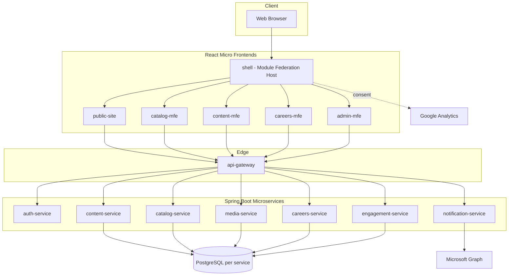

## 2. Micro-frontends (Module Federation recommended)

| MFE | Responsibility |
|-----|----------------|
| shell | Host app, routing, layout, Module Federation |
| public-site | Marketing pages, solutions, services, CSR, tech |
| catalog-mfe | Projects, case studies, clients, domain |
| content-mfe | News, blog/data sheets, gallery, timeline |
| careers-mfe | Careers listing and application |
| admin-mfe | Authenticated admin console |

**Integration pattern:** Webpack Module Federation (or equivalent) exposes remote modules loaded by `shell`. Shared component library (design tokens, header/footer, cookie consent) ships as a shared package to avoid duplication.

**Routing:** Shell owns top-level routes (`/`, `/solutions/:slug`, `/admin/*`). Legacy Struts `.action` URLs redirect via gateway rules during migration.

## 3. Backend microservices

| Service | Responsibility |
|---------|----------------|
| api-gateway | Edge routing, rate limiting, JWT validation |
| auth-service | Admin authentication, session/token issuance |
| content-service | News, blog/data sheets, banners, timeline, static pages metadata |
| catalog-service | Solutions, services, project products, Kran projects/solutions |
| media-service | Gallery groups/images, file uploads |
| careers-service | Job postings, applications, resume storage |
| engagement-service | Contact/enquiry forms, comments, application requests |
| admin-service | Aggregated admin operations or BFF for admin UI |
| notification-service | Microsoft Graph email dispatch |

**Communication:** Synchronous REST for reads; async messaging (optional) for email and bulk exports. No invented services beyond this list for v1 parity.

## 4. Comparison to existing stack

| Concern | Existing (As-Is) | Proposed (To-Be) |
|---------|------------------|------------------|
| UI | JSP + Tiles + jQuery | React MFEs |
| API | Struts `.action` | REST `/api/v1/*` |
| Auth | HTTP session `userBean` | JWT / server session via auth-service |
| Deployment | Single WAR | Independent service + MFE pipelines |
| Database | MariaDB monolith `kran_website` | PostgreSQL per microservice (Flyway, HikariCP) |
| ORM | Hibernate 4 monolith | Spring Data JPA / Hibernate 6 per service |
| XSS | ESAPI filter | Gateway + framework validators |

## 5. Security architecture

- Externalize admin credentials (remediation of `LoginAction.java` hardcoding).
- CAPTCHA on login and sensitive public POST endpoints.
- OWASP ASVS L2 targets for auth and input validation.
- Secrets for Microsoft Graph in vault, not `mail_setup` plaintext fields where avoidable.

## 6. Observability

- Centralized logging with correlation IDs propagated from gateway.
- Metrics: request rate, error rate, latency per service.
- Health: Spring Boot Actuator endpoints behind gateway allow-list.

## 7. Deployment view

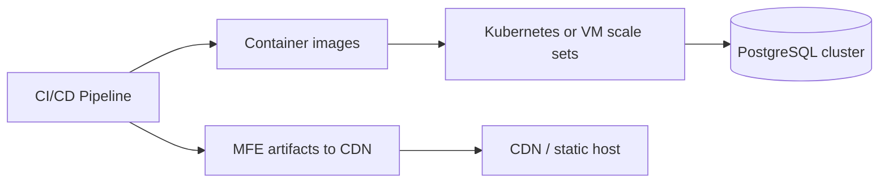

## 8. Migration strategy (high level)

1. Strangle legacy: expose read APIs over existing tables.
2. Stand up MFE shell with public read-only routes.
3. Move admin CRUD to admin-mfe + APIs.
4. Decommission Struts actions per route group with redirect map.

---

# API Requirements

**Date:** 2026-11-04

## 1. Principles

- REST JSON over HTTPS; OpenAPI 3 document per service.
- Legacy Struts endpoints use `.action` suffix and mixed GET/POST; proposed APIs use nouns and HTTP verbs.
- Public read endpoints cached at CDN/gateway where safe.

## 2. API catalog

| Method | Path | Auth | Service | Legacy Struts | Description |
|--------|------|------|---------|---------------|-------------|
| POST | `/api/v1/auth/login` | Public | auth-service | LoginAction.login | Admin login with CAPTCHA |
| POST | `/api/v1/auth/logout` | Admin | auth-service | session invalidate | Invalidate session/token |
| GET | `/api/v1/auth/captcha` | Public | auth-service | captcha / CaptchaInner | Generate CAPTCHA challenge |
| GET | `/api/v1/auth/me` | Admin | auth-service | userBean session | Current admin profile |
| GET | `/api/v1/banners/active` | Public | content-service | viewBanner | Active banners |
| GET | `/api/v1/testimonials` | Public | content-service | viewTestimonial | Testimonials list |
| GET | `/api/v1/news` | Public | content-service | news, viewNews | Paginated news |
| GET | `/api/v1/news/{id}` | Public | content-service | newsDetail | News detail |
| GET | `/api/v1/blogs` | Public | content-service | blog | Blog list |
| GET | `/api/v1/blogs/{id}` | Public | content-service | readBlog | Blog detail |
| GET | `/api/v1/data-sheets` | Public | content-service | datasheets | Data sheets (blog alias) |
| GET | `/api/v1/timeline` | Public | content-service | timeline | Company timeline |
| GET | `/api/v1/galleries` | Public | media-service | gallery | Gallery groups |
| GET | `/api/v1/galleries/{id}` | Public | media-service | galleryView | Gallery detail |
| GET | `/api/v1/galleries/{id}/images` | Public | media-service | galleryAjax | Gallery images AJAX |
| GET | `/api/v1/solutions` | Public | catalog-service | allsolutions | All solutions |
| GET | `/api/v1/solutions/probity-financials` | Public | catalog-service | solutions?val=probity-financials | Solution detail probity-financials |
| GET | `/api/v1/solutions/audit-management-system` | Public | catalog-service | solutions?val=audit-management-system | Solution detail audit-management-system |
| GET | `/api/v1/solutions/sirius` | Public | catalog-service | solutions?val=sirius | Solution detail sirius |
| GET | `/api/v1/solutions/charitable-endowments-platform` | Public | catalog-service | solutions?val=charitable-endowments-platform | Solution detail charitable-endowments-platform |
| GET | `/api/v1/solutions/comprehensive-loan-management-system` | Public | catalog-service | solutions?val=comprehensive-loan-management-system | Solution detail comprehensive-loan-management-system |
| GET | `/api/v1/solutions/project-monitoring-information-system` | Public | catalog-service | solutions?val=project-monitoring-information-system | Solution detail project-monitoring-information-system |
| GET | `/api/v1/solutions/report-monitoring-information-system` | Public | catalog-service | solutions?val=report-monitoring-information-system | Solution detail report-monitoring-information-system |
| GET | `/api/v1/solutions/inspection-management-system` | Public | catalog-service | solutions?val=inspection-management-system | Solution detail inspection-management-system |
| GET | `/api/v1/solutions/phoenix` | Public | catalog-service | solutions?val=phoenix | Solution detail phoenix |
| GET | `/api/v1/solutions/centralized-welfare-management-system` | Public | catalog-service | solutions?val=centralized-welfare-management-system | Solution detail centralized-welfare-management-system |
| GET | `/api/v1/solutions/{slug}` | Public | catalog-service | solutions?val= | Solution detail by slug |
| GET | `/api/v1/services` | Public | catalog-service | getService | Service offerings list |
| GET | `/api/v1/services/consultancy` | Public | catalog-service | getService val=consultancy | Service detail consultancy |
| GET | `/api/v1/services/software-development` | Public | catalog-service | getService val=software-development | Service detail software-development |
| GET | `/api/v1/services/mobile-app-development` | Public | catalog-service | getService val=mobile-app-development | Service detail mobile-app-development |
| GET | `/api/v1/services/project-product-implementation` | Public | catalog-service | getService val=project-product-implementation | Service detail project-product-implementation |
| GET | `/api/v1/services/maintenance-support` | Public | catalog-service | getService val=maintenance-support | Service detail maintenance-support |
| GET | `/api/v1/services/porting-migration` | Public | catalog-service | getService val=porting-migration | Service detail porting-migration |
| GET | `/api/v1/projects` | Public | catalog-service | projects, kranprojects | Projects listing |
| GET | `/api/v1/projects/{id}` | Public | catalog-service | readProject, projectDetail | Project detail |
| GET | `/api/v1/case-studies` | Public | catalog-service | casestudies | Case studies |
| GET | `/api/v1/case-studies/{id}` | Public | catalog-service | readCase | Case study detail |
| GET | `/api/v1/clients` | Public | catalog-service | clients | Clients |
| GET | `/api/v1/pages/about` | Public | content-service | aboutus | Page content about |
| GET | `/api/v1/pages/contact` | Public | content-service | contact | Page content contact |
| GET | `/api/v1/pages/domain` | Public | content-service | domain | Page content domain |
| GET | `/api/v1/pages/csr` | Public | content-service | krancsr | Page content csr |
| GET | `/api/v1/pages/tech` | Public | content-service | krantech | Page content tech |
| GET | `/api/v1/pages/team` | Public | content-service | teammanagement | Page content team |
| GET | `/api/v1/pages/careers-overview` | Public | content-service | overview | Page content careers-overview |
| POST | `/api/v1/enquiries` | Public | engagement-service | submitEnquiry, enquire, contact | Contact/enquiry submit |
| POST | `/api/v1/messages` | Public | engagement-service | sendMsg | Send message |
| POST | `/api/v1/forms/k-projects` | Public | engagement-service | submitKProjects | K Projects form |
| POST | `/api/v1/forms/k-solutions` | Public | engagement-service | submitKSolutions | K Solutions form |
| POST | `/api/v1/consent` | Public | engagement-service | cookie consent actions | Cookie consent |
| GET | `/api/v1/search` | Public | content-service | search/result | Site search |
| GET | `/api/v1/jobs` | Public | careers-service | career | Open jobs |
| GET | `/api/v1/jobs/{id}` | Public | careers-service | jobApply | Job detail |
| POST | `/api/v1/jobs/{id}/applications` | Public | careers-service | saveCandidate, submitCareerForm | Submit application |
| GET | `/api/v1/admin/dashboard` | Admin | admin-service | dashboard | Dashboard metrics |
| GET | `/api/v1/admin/requests` | Admin | engagement-service | request | Contact requests |
| GET | `/api/v1/admin/solution-requests` | Admin | engagement-service | solRequest | Solution requests |
| GET | `/api/v1/admin/jobs` | Admin | careers-service | adminCareer | Jobs admin list |
| POST | `/api/v1/admin/jobs` | Admin | careers-service | saveJob, careerAdd | Create job |
| PUT | `/api/v1/admin/jobs/{id}` | Admin | careers-service | editJob | Update job |
| PATCH | `/api/v1/admin/jobs/{id}/deactivate` | Admin | careers-service | jobDeactivate | Deactivate job |
| PUT | `/api/v1/admin/jobs/no-vacancy` | Admin | careers-service | NoVacancy | Global no vacancy |
| GET | `/api/v1/admin/applications` | Admin | careers-service | jobApplications | Applications list |
| GET | `/api/v1/admin/applications/{id}/resume` | Admin | careers-service | downloadDoc | Download resume |
| POST | `/api/v1/admin/applications/export` | Admin | careers-service | downloadFilteredResumes | Bulk resume export |
| POST | `/api/v1/admin/news` | Admin | content-service | adminNews | Create news |
| PUT | `/api/v1/admin/news/{id}` | Admin | content-service | adminNews | Update news |
| DELETE | `/api/v1/admin/news/{id}` | Admin | content-service | adminNews | Delete news |
| CRUD | `/api/v1/admin/gallery-groups` | Admin | media-service | adminGallery groups | Gallery groups |
| CRUD | `/api/v1/admin/gallery-images` | Admin | media-service | adminGallery images | Gallery images |
| CRUD | `/api/v1/admin/kran-projects` | Admin | catalog-service | adminKranProjects | Kran projects |
| CRUD | `/api/v1/admin/kran-solutions` | Admin | catalog-service | adminKranSolutions | Kran solutions |
| CRUD | `/api/v1/admin/kran-seniors` | Admin | catalog-service | adminKranSeniors | Kran seniors |
| CRUD | `/api/v1/admin/kran-faces` | Admin | catalog-service | adminKranFaces | Kran faces |
| CRUD | `/api/v1/admin/timeline` | Admin | content-service | adminKranTimeline | Timeline entries |
| CRUD | `/api/v1/admin/project-products` | Admin | catalog-service | getProjectProduct | Project products |
| CRUD | `/api/v1/admin/banners` | Admin | content-service | adminBanner | Banners |
| CRUD | `/api/v1/admin/data-sheets` | Admin | content-service | adminBlogs | Data sheets/blogs |
| CRUD | `/api/v1/admin/case-studies` | Admin | catalog-service | adminCase | Case studies |
| CRUD | `/api/v1/admin/categories` | Admin | catalog-service | categorySetup | Categories |
| PUT | `/api/v1/admin/mail-setup` | Admin | notification-service | mailSetup | Mail/Graph settings |
| POST | `/api/v1/notifications/email` | Admin | notification-service | mail integration | Send email via Graph |
| GET | `/api/v1/admin/comments` | Admin | engagement-service | comments | List comments |
| DELETE | `/api/v1/admin/comments/{id}` | Admin | engagement-service | comments | Delete comment |

**Total proposed API operations/rows:** 85

## 3. Non-functional API requirements

- **NFR-API-001:** All admin routes require valid bearer token or session cookie issued by auth-service.
- **NFR-API-002:** Error model: RFC 7807 problem+json.
- **NFR-API-003:** Pagination: `page`, `size`, `sort` query parameters on list endpoints.
- **NFR-API-004:** Idempotency-Key header on enquiry/application POST endpoints.

---

# Database Requirements

**Date:** 2026-11-04  
**Mandatory target RDBMS:** **PostgreSQL** (Spring Data JPA / Hibernate, Flyway, HikariCP)  
**Existing system RDBMS:** **MariaDB/MySQL** schema `kran_website` — analyzed separately; **not** PostgreSQL

---

## 1. Executive summary

The new application shall use **PostgreSQL** as the sole relational database technology. The legacy monolith uses MariaDB with nineteen Hibernate-mapped tables in schema `kran_website`. The rebuild adopts **database-per-microservice** in production (recommended), with **schema-per-service** on a shared PostgreSQL instance for development/CI. No microservice may read or write another service’s tables.

Detailed artifacts live under **`postgresql/`** in this SRS folder.

---

## 2. Existing database analysis (MariaDB)

| Attribute | Value |
|-----------|--------|
| Engine | MariaDB (MySQL dialect in Hibernate) |
| Schema | `kran_website` |
| Configuration | `WEB-INF/spring/DataSource.xml`, `HibernateSessionFactory.xml` |
| ORM | Hibernate 4.3 annotations on `com.kran.project.admin.vo.*` |
| Partial DDL | `db_dump/db ater.txt` in legacy git repo |
| Connection pool | HikariCP (also used in `Database.java` for ad-hoc JDBC) |

### 2.1 Legacy entity / table inventory (19)

| # | Table | Primary use |
|---|-------|-------------|
| 1 | contacts | Enquiries, contact form |
| 2 | careers | Job postings |
| 3 | news | News & events |
| 4 | application_request | Job applications (FK to careers) |
| 5 | gallery | Gallery images |
| 6 | gallgroup | Gallery groups |
| 7 | project_product | Legacy product/project catalog |
| 8 | banner | Home banners |
| 9 | blog | Data sheets (admin label) |
| 10 | comments | Blog comments |
| 11 | mail_setup | Email routing by type |
| 12 | category | Reference categories |
| 13 | submitted_resumes | General resume submissions |
| 14 | casestudy | Case studies |
| 15 | kran_faces | Team faces |
| 16 | kran_seniors | Senior leadership |
| 17 | kran_projects | Project portfolio |
| 18 | kran_solutions | Solution portfolio |
| 19 | kran_timeline | Company timeline |

### 2.2 Known legacy constraints

- FK: `gallery.group_id` → `gallgroup.group_Id` (documented in db dump).
- FK: `application_request.career_Id` → `careers.id` (Hibernate).
- Mixed column naming (`active_Status` vs `active_status`).
- Admin users **not** stored in database (hardcoded login).

---

## 3. Proposed PostgreSQL architecture

| Topic | Document |
|-------|----------|
| Architecture, service mapping, ER diagrams | [postgresql/PostgreSQL_Database_Architecture.md](postgresql/PostgreSQL_Database_Architecture.md) |
| Column-level data dictionary | [postgresql/Data_Dictionary.md](postgresql/Data_Dictionary.md) |
| FK and logical relationships | [postgresql/Table_Relationships.md](postgresql/Table_Relationships.md) |
| MariaDB → PostgreSQL migration | [postgresql/Migration_Strategy_MariaDB_to_PostgreSQL.md](postgresql/Migration_Strategy_MariaDB_to_PostgreSQL.md) |
| Security & access control | [postgresql/Security_Requirements.md](postgresql/Security_Requirements.md) |
| Performance, backup, DR | [postgresql/Performance_Backup_Requirements.md](postgresql/Performance_Backup_Requirements.md) |
| Flyway DDL (baseline) | [postgresql/ddl/](postgresql/ddl/) |

**Recommendation:** Production = **one PostgreSQL database per microservice**; dev = one instance, **one schema per service**, same ownership rules.

---

## 4. PostgreSQL standards (mandatory)

- Appropriate types: `TEXT`, `VARCHAR(n)`, `TIMESTAMPTZ`, `BIGINT`, `UUID` where justified, `NUMERIC` for money (future).
- Primary keys: `BIGINT` identity for migrated entities; **preserve legacy ids** on import; `UUID` for new auth entities.
- Timestamps: `TIMESTAMPTZ`; application timezone Asia/Kolkata.
- Avoid `DOUBLE` for phone numbers; use `VARCHAR(20)`.
- Constraints: `CHECK`, `NOT NULL`, `UNIQUE`, intra-service `FOREIGN KEY`.
- Indexes: partial indexes for active/public rows; GIN for full-text where needed.
- Migrations: **Flyway** versioned SQL only (`ddl-auto=validate` in prod).
- Pooling: **HikariCP** per service.

---

## 5. Cross-cutting database requirements

| ID | Requirement |
|----|-------------|
| DB-REQ-001 | Each microservice connects only to its PostgreSQL database. |
| DB-REQ-002 | Cross-domain references use logical ids, not cross-DB FKs. |
| DB-REQ-003 | Admin-managed rows include audit columns (`created_at`, `created_by`, `updated_at`, `updated_by`). |
| DB-REQ-004 | Soft delete (`deleted_at`) on CMS entities; archive pattern for PII submissions. |
| DB-REQ-005 | List APIs use paginated, sortable queries; keyset pagination for large tables. |
| DB-REQ-006 | Transactions scoped to single service; outbox for email side effects. |
| DB-REQ-007 | Flyway migrations reviewed in CI before deploy. |
| DB-REQ-008 | Legacy MariaDB data migrated with row-count and PK validation gates. |

---

## 6. Functional requirement traceability

Database work supports FR modules: content (news, blog, banner, timeline), catalog (projects, solutions, case studies), media (gallery), careers (jobs, applications), engagement (contacts, comments), notification (mail_setup).

See **Requirements_Traceability_Matrix.xlsx** for FR ↔ service mapping.

---

## 7. Open issues

- Full `request_type` enum for contacts (confirm all legacy codes).
- Search: PostgreSQL FTS vs OpenSearch (OQ-005).
- Resume storage: DB path vs object storage URI (OQ-004).
- HR data retention (OQ-013).

---

## 8. Revision note

When PostgreSQL documentation changes, update files under `postgresql/` and regenerate `KranConsulting_SRS.docx` via `generate_deliverables.py`.


---


---

## Appendix: PostgreSQL architecture (full)

## PostgreSQL Database Architecture — KranConsulting Rebuild

**Status:** Mandatory target architecture (proposed)  
**Date:** 2026-11-04  
**Existing system:** MariaDB/MySQL schema `kran_website` (Hibernate 4, single monolith) — **not PostgreSQL**

---

### 1. Technology stack (target)

| Component | Selection |
|-----------|-----------|
| RDBMS | **PostgreSQL** 15+ (LTS track) |
| ORM | Spring Data JPA / Hibernate 6.x |
| Migrations | **Flyway** (preferred) or Liquibase |
| Connectivity | Spring `DataSource`, JDBC |
| Pooling | **HikariCP** (per service) |
| Time types | `TIMESTAMPTZ` for business timestamps (Asia/Kolkata app layer) |
| Money | `NUMERIC(p,s)` — not used in current legacy CMS tables |
| Primary keys | `BIGINT GENERATED BY DEFAULT AS IDENTITY`; preserve migrated legacy `id` values |

---

### 2. Architecture decision: database-per-service vs schema-per-service

#### Options evaluated

| Criterion | Separate PostgreSQL **database** per microservice | Separate **schema** per microservice (one PostgreSQL cluster) |
|-----------|---------------------------------------------------|----------------------------------------------------------------|
| Data isolation | Strong; no accidental cross-join | Good with role `search_path` + REVOKE |
| Blast radius | Instance failure affects one DB if clustered per DB | Shared instance failure affects all |
| Connection pools | Independent Hikari pools per service | Shared instance, separate pools per schema |
| Flyway | One migration history per database | One Flyway history per schema (custom locations) |
| Ops complexity | Higher (more DBs to backup/monitor) | Lower for small teams |
| Cross-service FK | **Prohibited** (by design) | **Prohibited** across schemas |
| Scale-out | Aligns with independent service scaling | Vertical scale first |

#### Recommendation

| Environment | Approach |
|-------------|----------|
| **Production** | **Separate PostgreSQL database per microservice** on a managed cluster (e.g. RDS/Aurora, Azure Flexible Server, or self-hosted Patroni). |
| **Development / CI** | Single PostgreSQL instance with **one schema per service** mirroring production ownership rules (same table names forbidden across schemas except read replicas). |

**Architecture rule:** No microservice may obtain JDBC credentials or JPA mappings for another service’s tables. Cross-domain references use **logical IDs** (`BIGINT` or `UUID`) without cross-database foreign keys. Referential integrity across boundaries is enforced via APIs, events, or eventual consistency.

---

### 3. Service-to-database mapping

| Microservice | PostgreSQL database (prod) | Schema (dev) | Legacy MariaDB tables |
|--------------|----------------------------|--------------|------------------------|
| auth-service | `kran_auth` | `auth` | *(none — legacy admin was hardcoded)* |
| content-service | `kran_content` | `content` | `news`, `banner`, `blog`, `kran_timeline` |
| catalog-service | `kran_catalog` | `catalog` | `category`, `casestudy`, `kran_projects`, `kran_solutions`, `kran_faces`, `kran_seniors`, `project_product` |
| media-service | `kran_media` | `media` | `gallgroup`, `gallery` |
| careers-service | `kran_careers` | `careers` | `careers`, `application_request`, `submitted_resumes` |
| engagement-service | `kran_engagement` | `engagement` | `contacts`, `comments` |
| notification-service | `kran_notification` | `notification` | `mail_setup` (+ new `outbound_email_log`) |

---

### 4. Cross-service references (logical, not FK)

| From table | Column | References (logical) | Resolution |
|------------|--------|----------------------|------------|
| `comments` | `blog_id` | content-service `blog.id` | Validate via content API or cached id registry |
| `application_request` | `career_id` | careers-service `careers.id` | FK **within** `kran_careers` only |
| `gallery` | `group_id` | media-service `gallgroup.group_id` | FK **within** `kran_media` only |
| Enquiry payloads | `product_name` | catalog/content | Denormalized snapshot at submit time |

---

### 5. Normalization and legacy denormalization

- Legacy `blog.category` and `casestudy.category` store **string** category names; target model adds optional `category_id BIGINT` referencing `catalog.category` via API-synchronized id, retaining `category_label` for legacy parity during migration.
- Legacy `active_Status` / `active_status` char flags map to `VARCHAR(1)` (`Y`/`N`) plus optional `is_active BOOLEAN GENERATED` or application mapping — migration script converts consistently.
- `kran_projects` service flag columns (`service_con`, etc.) remain columns (wide table) in v1 for parity; v2 may normalize to `kran_project_service` child table (Requires Business Confirmation).

---

### 6. Audit and soft delete

All admin-managed entities include:

| Column | Type | Purpose |
|--------|------|---------|
| `created_at` | `TIMESTAMPTZ NOT NULL DEFAULT now()` | Row creation |
| `created_by` | `VARCHAR(128)` | Admin user id or subject from JWT |
| `updated_at` | `TIMESTAMPTZ NOT NULL DEFAULT now()` | Last mutation |
| `updated_by` | `VARCHAR(128)` | Last editor |
| `deleted_at` | `TIMESTAMPTZ NULL` | Soft delete when business requires retain history |
| `deleted_by` | `VARCHAR(128) NULL` | Soft delete actor |

**Soft delete applies to:** `news`, `blog`, `banner`, `casestudy`, `careers`, `kran_*` catalog rows, `gallgroup`, `gallery`, `project_product`, `category`, `mail_setup`.  
**Hard retain + archive:** `contacts`, `application_request`, `submitted_resumes` (compliance); soft delete via `archived_at` instead of physical delete.

Public queries default: `WHERE deleted_at IS NULL AND is_active = true` (or legacy `active_status = 'Y'`).

---

### 7. Transaction management

| Pattern | Usage |
|---------|--------|
| Local `@Transactional` | Single-service create/update (e.g. gallery group + images in media-service) |
| Outbox table (optional) | notification-service email dispatch after enquiry commit |
| Saga / compensation | Not required for v1 CMS parity; document if order workflows added |
| Read-only transactions | All public list/detail repository methods |
| Isolation | Default `READ COMMITTED`; optimistic locking via `@Version BIGINT` on contested admin entities |

---

### 8. Pagination and sorting

- API: `page` (0-based), `size` (default 20, max 100), `sort=field,asc|desc`.
- PostgreSQL: `ORDER BY` on indexed columns; **keyset pagination** (`WHERE id > :cursor ORDER BY id LIMIT :n`) for large admin lists.
- Avoid `OFFSET` for deep pages on high-volume tables (`contacts`, `comments`).

---

### 9. Indexing strategy (summary)

- PK clustered on `id` (default heap).
- Partial indexes: `CREATE INDEX ... ON news (posted_on DESC) WHERE deleted_at IS NULL AND active_status = 'Y';`
- FK columns: `gallery(group_id)`, `application_request(career_id)`, `comments(blog_id)`.
- Search: PostgreSQL `GIN` on `to_tsvector('english', title || ' ' || coalesce(body,''))` for news/blog/casestudy — or external OpenSearch (see Open Questions OQ-005).

---

### 10. ER diagrams (per bounded context)

#### 10.1 Content service (`kran_content`)

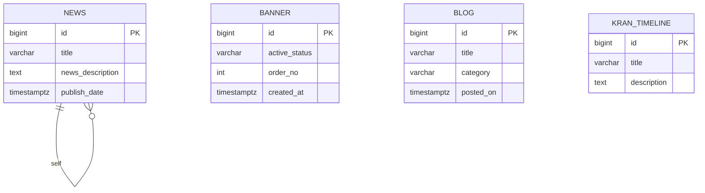

#### 10.2 Media service (`kran_media`)

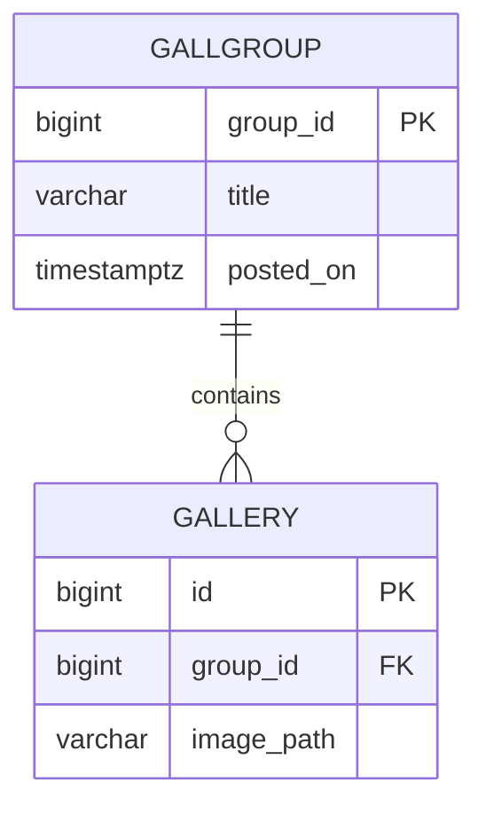

#### 10.3 Careers service (`kran_careers`)

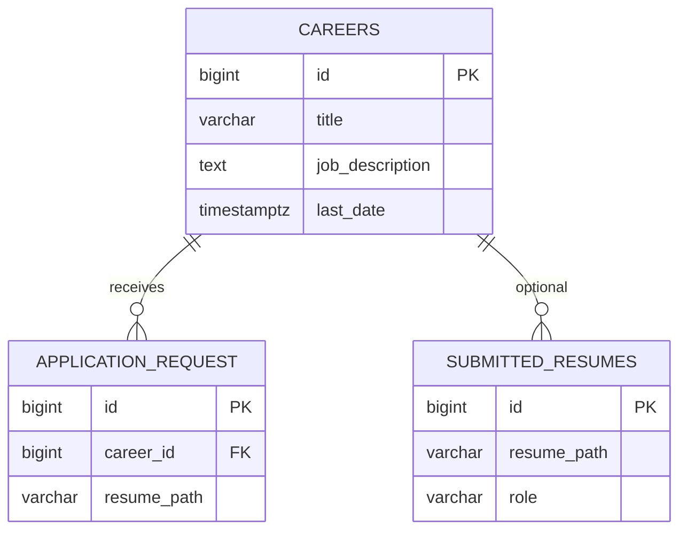

#### 10.4 Engagement service (`kran_engagement`)

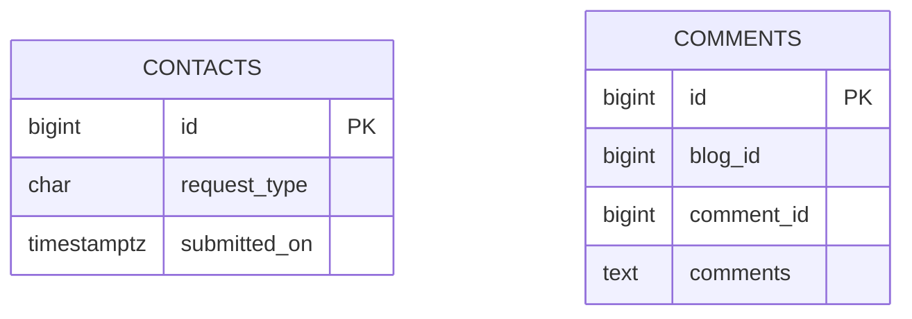

#### 10.5 Catalog service (`kran_catalog`)

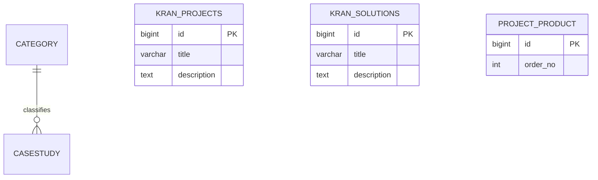

---

### 11. Deliverable index

| Document | Path |
|----------|------|
| Data dictionary | `postgresql/Data_Dictionary.md` |
| Table relationships | `postgresql/Table_Relationships.md` |
| Flyway DDL scripts | `postgresql/ddl/*/V001__baseline.sql` |
| MariaDB → PostgreSQL migration | `postgresql/Migration_Strategy_MariaDB_to_PostgreSQL.md` |
| Security | `postgresql/Security_Requirements.md` |
| Performance & backup | `postgresql/Performance_Backup_Requirements.md` |

---

### 12. Connection configuration (per service)

```yaml
## Example Spring Boot 3 — content-service
spring:
  datasource:
    url: jdbc:postgresql://${PG_HOST}:5432/kran_content?sslmode=require
    username: ${KRAN_CONTENT_DB_USER}
    password: ${KRAN_CONTENT_DB_PASSWORD}
    hikari:
      maximum-pool-size: 20
      minimum-idle: 5
      connection-timeout: 30000
  jpa:
    hibernate:
      ddl-auto: validate
    properties:
      hibernate.jdbc.time_zone: Asia/Kolkata
  flyway:
    enabled: true
    locations: classpath:db/migration
```

**Rule:** `ddl-auto` never `update` in production; schema changes only via Flyway.

---

# Business Workflows

**Date:** 2026-11-04

## 1. Admin authentication (existing vs proposed)

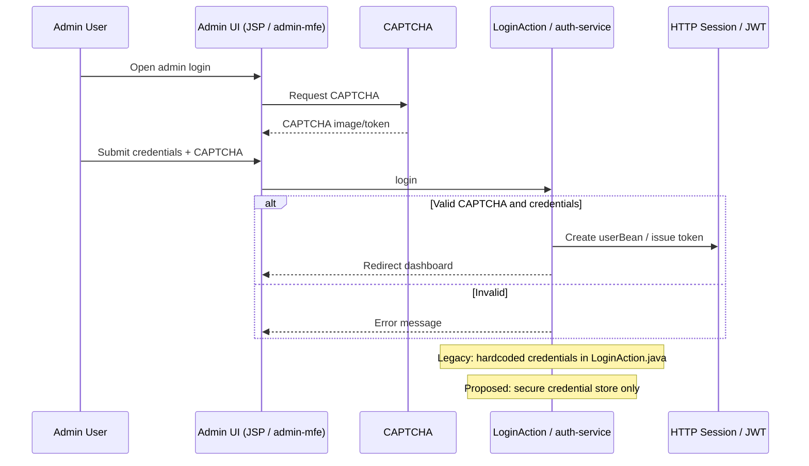

## 2. Public enquiry submission

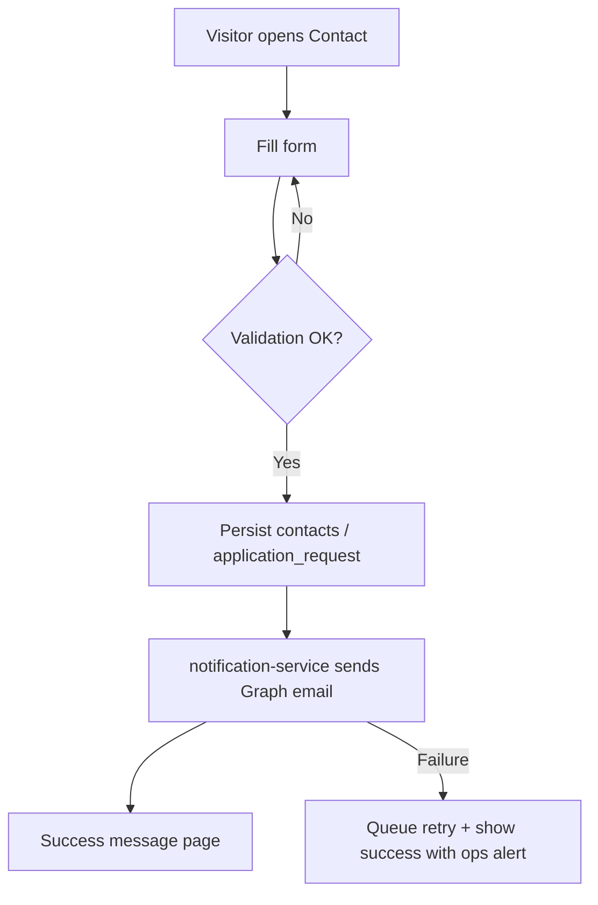

## 3. Job application

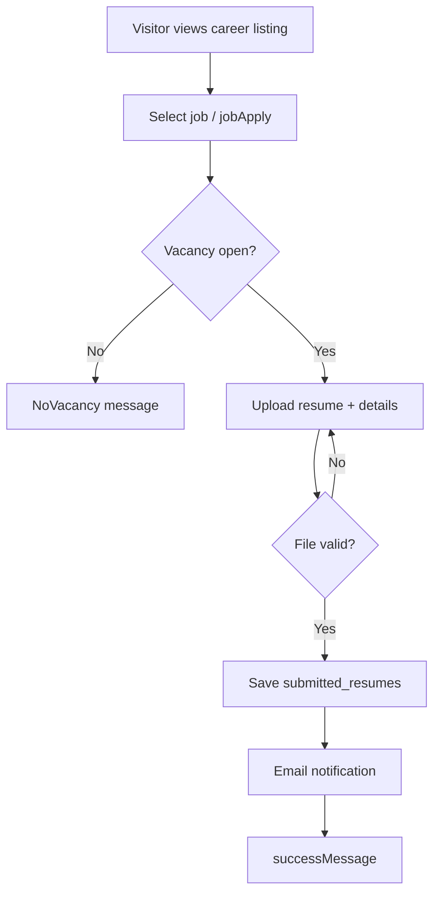

## 4. Admin CRUD (generic content)

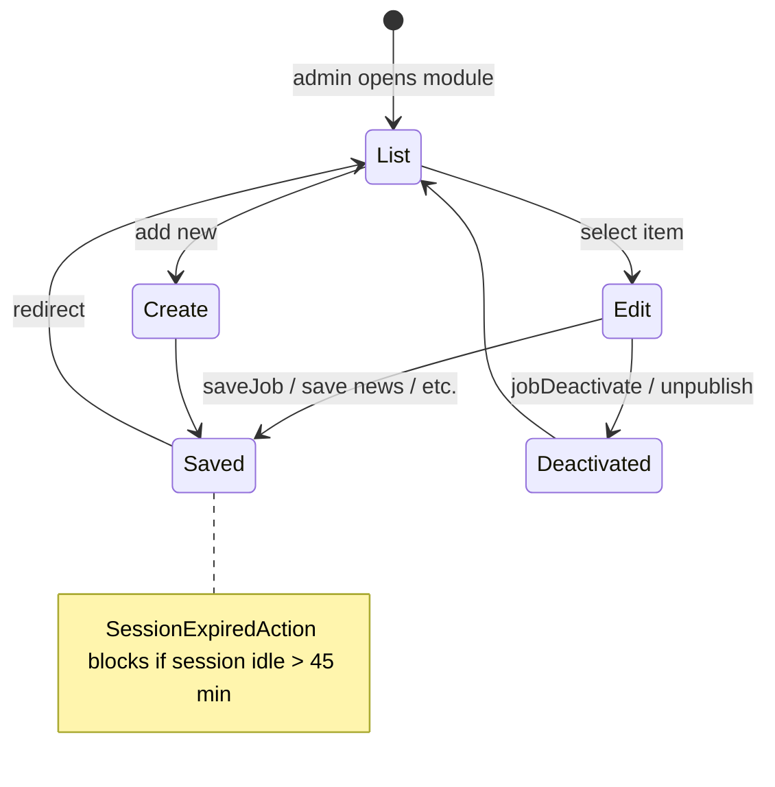

## 5. Cookie consent and analytics

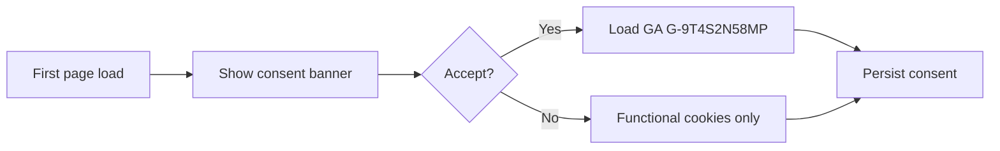

---

# Non-Functional Requirements

**Date:** 2026-11-04 | **Status:** Proposed targets (Requires Business Confirmation where noted)

## Performance (NFR-PER)

| ID | Requirement | Metric / Target |
|----|-------------|-----------------|
| NFR-PER-001 | Public marketing pages (cached shell + API) shall load primary content within 3 seconds on 4G for 95th percentile users. | Requires Business Confirmation |
| NFR-PER-002 | Public read APIs shall respond within 500 ms p95 under nominal load (100 concurrent users). | Requires Business Confirmation |
| NFR-PER-003 | Admin list endpoints shall support pagination default size 20, max 100. | Mandatory |
| NFR-PER-004 | Resume upload shall accept files up to 50 MB (parity with Struts multipart maxSize). | Existing: 50 MB |
| NFR-PER-005 | Gallery and media assets shall be served via CDN with cache headers. | Proposed |

## Security (NFR-SEC)

| ID | Requirement |
|----|-------------|
| NFR-SEC-001 | All traffic over HTTPS; HSTS enabled at gateway. |
| NFR-SEC-002 | Admin credentials shall not be stored in source code; secrets in vault/env. |
| NFR-SEC-003 | JWT/session tokens httpOnly where cookie-based; CSRF protection on state-changing browser forms. |
| NFR-SEC-004 | Input validation on all API DTOs; parameterized queries via JPA. |
| NFR-SEC-005 | XSS mitigation via React escaping + Content-Security-Policy headers. |
| NFR-SEC-006 | Rate limiting on login, enquiry, and job application endpoints. |
| NFR-SEC-007 | Resume downloads restricted to authenticated admin roles. |
| NFR-SEC-008 | Audit log for admin login and content publish events. |

## Scalability & Availability (NFR-SCA / NFR-AVL)

| ID | Requirement |
|----|-------------|
| NFR-SCA-001 | Each micro-frontend and microservice independently deployable. |
| NFR-SCA-002 | Stateless API instances horizontally scalable behind load balancer. |
| NFR-AVL-001 | Each service exposes `/actuator/health` (Spring Boot Actuator). |
| NFR-AVL-002 | Graceful degradation: public read pages remain available if admin services fail. |

## Maintainability (NFR-MNT)

| ID | Requirement |
|----|-------------|
| NFR-MNT-001 | OpenAPI 3 spec per service; shared error model. |
| NFR-MNT-002 | Unit test coverage minimum 70% for service business logic (proposed). |
| NFR-MNT-003 | Shared ESLint/Prettier and Java checkstyle aligned to org standards. |

## Accessibility & Usability (NFR-UX)

| ID | Requirement |
|----|-------------|
| NFR-UX-001 | Public site WCAG 2.2 Level AA compliance for new UI components. |
| NFR-UX-002 | Keyboard navigable main menu and forms; visible focus indicators. |
| NFR-UX-003 | Responsive layouts for desktop, tablet, and mobile (replace separate mobile JSP routes where feasible). |
| NFR-UX-004 | Cookie consent banner before non-essential analytics (parity with GA consent mode). |

## Compatibility (NFR-CMP)

| ID | Requirement |
|----|-------------|
| NFR-CMP-001 | Support latest two major versions of Chrome, Edge, Firefox, Safari. |
| NFR-CMP-002 | API versioning prefix `/api/v1/` with backward-compatible deprecation policy. |

---

# User Interface Requirements

**Date:** 2026-11-04

## Brand and layout (as-is reference)

- **Brand:** KRAN Consulting corporate identity; red accent (`#c80808` in admin sidebar active state).
- **Typography:** Montserrat, Roboto, Lato, Poppins, Raleway (Google Fonts) — consolidate to design tokens in rebuild.
- **Header:** Multi-level navigation (Services mega-menu, About, Careers, Case Studies, Data Sheets, News, Gallery, Contact); external link to cpart.in.
- **Footer:** Social links (Facebook, LinkedIn, Instagram, YouTube).
- **Admin:** Bootstrap-based sidebar (`SideMenu.jsp`), DataTables, datetime pickers, drag-and-drop banner ordering.

## Reusable UI architecture (proposed)

- Shared component library: Header, Footer, CookieBanner, CaptchaField, DataTable, RichTextEditor, FileUpload, ConfirmDialog, Toast notifications.
- Form patterns: inline validation, consistent error messages, loading/disabled submit states.
- Table patterns: sort, filter, pagination for admin lists matching current DataTables behavior.
- Empty/error states for all public list pages (news, careers, gallery).

---

# Testing and Acceptance Criteria

**Date:** 2026-11-04

| Layer | Scope |
|-------|--------|
| Unit | Service domain logic, validators, mappers |
| Component | React shared library and MFE pages (Vitest/React Testing Library) |
| API | Contract tests from OpenAPI; auth and RBAC negative tests |
| Integration | MFE ↔ API Gateway ↔ services; Graph email stub |
| E2E | Playwright/Cypress: home, contact, job apply, admin login, news CRUD smoke |
| Security | OWASP ZAP baseline; dependency scanning |
| Performance | k6 load on public read APIs |
| Accessibility | axe-core on top public templates |
| UAT | Business sign-off per module in page inventory |

Major module acceptance: each FR in Functional_Requirements.md maps to test case `TC-<n>` in Requirements_Traceability_Matrix.xlsx.

---

# Migration and Implementation Roadmap

**Date:** 2026-11-04 | No dates assigned — dependency order only.

| Phase | Activities |
|-------|------------|
| 1 | SRS review, open question resolution, architecture sign-off |
| 2 | Design system + shell MFE + API Gateway skeleton |
| 3 | auth-service, notification-service (Graph), reference data |
| 4 | content-service + public news/gallery/banner MFE routes |
| 5 | catalog-service + solutions/projects MFE (largest content migration) |
| 6 | careers-service + engagement-service + forms |
| 7 | admin-mfe feature parity with SideMenu modules |
| 8 | URL redirects from `.action` to SPA routes; SEO validation |
| 9 | SIT, security/performance testing, UAT |
| 10 | Production cutover (phased strangler recommended — see OQ-010) |

**Dependencies:** Auth before admin MFE; media-service before gallery; notification-service before form go-live.

---

# Functional Completeness Report

**Date:** 2026-11-04

## Acceptance checklist (Master Prompt §10)

| # | Condition | Status | Evidence |
|---|-----------|--------|----------|
| 1 | All discoverable modules inventoried | **Yes** | SideMenu + login-config + Header |
| 2 | All pages documented | **Yes** | Complete_Application_Sitemap.md |
| 3 | Workflows analyzed | **Yes** | Module_Wise_Workflow_Analysis.md |
| 4 | Preservation requirements | **Yes** | FR-001–FR-080 |
| 5 | Gaps identified | **Yes** | GAP-001–GAP-025 |
| 6 | Enterprise enhancements evaluated | **Yes** | Enterprise_Functionality_Recommendations.md |
| 7 | Unified architecture documented | **Yes** | Future_State_Application_Architecture.md |
| 8 | MFE boundaries | **Yes** | System_Architecture.md |
| 9 | Microservices + PostgreSQL | **Yes** | postgresql/*, Database_Requirements.md |
| 10 | API traceability | **Yes** | API_Requirements.md |
| 11 | Security documented | **Yes** | postgresql/Security_Requirements.md, gaps GAP-001/022 |
| 12 | Testing criteria | **Yes** | Testing section in master SRS |
| 13 | Open questions | **Yes** | Open_Questions.md |

## Outstanding business confirmations

See gaps marked **Biz confirm = Yes** in `Existing_Functionality_Gap_Analysis.md` and `Open_Questions.md`.

## CRUD coverage statement

Legacy CMS supports **Create, Read, Update, Deactivate** for most admin entities. **Hard delete** is rare (e.g. gallery deleteImage). **Approve/Reject/Draft** workflows are **not present** — documented as gaps, not hidden.

---

# Open Questions

**Date:** 2026-11-04

| ID | Topic | Question | Impact |
|----|-------|----------|--------|
| OQ-001 | Identity | Will admin remain single-user or integrate Azure AD / SSO? | auth-service design |
| OQ-002 | Credentials | Target secret store (Azure Key Vault, HashiCorp Vault, env-only)? | deployment |
| OQ-003 | URL migration | Permanent 301 map for every `.action` URL? | SEO, gateway rules |
| OQ-004 | Resume storage | Keep BLOB in MariaDB vs S3-compatible object store? | careers-service |
| OQ-005 | Search | MariaDB FULLTEXT vs Elasticsearch/OpenSearch? | content-service |
| OQ-006 | Mobile variants | Separate mobile solution slugs — deprecate or responsive only? | catalog-mfe |
| OQ-007 | Comments | Public comment submission on blogs — retain? | engagement-service |
| OQ-008 | Mail setup | Which mail_setup fields may remain in DB vs vault? | notification-service |
| OQ-009 | Session vs JWT | Pure JWT or server-side session cluster? | gateway auth |
| OQ-010 | Cutover | Big-bang vs phased strangler per route group? | release plan |
| OQ-011 | Data Sheets | Public URL naming: `/blog` vs `/data-sheets` canonical? | routing |
| OQ-012 | CAPTCHA | reCAPTCHA vs retained CaptchaInner equivalent? | auth-service |
| OQ-013 | HR retention | Resume retention period and right-to-erasure process? | compliance |
| OQ-014 | kran-framework | Reuse ES2-1.1 utilities in services or reimplement? | shared libraries |
| OQ-015 | Analytics | Additional tags (LinkedIn, Meta) beyond GA? | consent banner |

---
