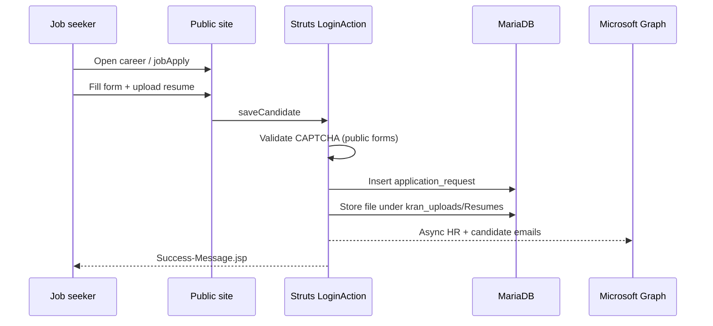
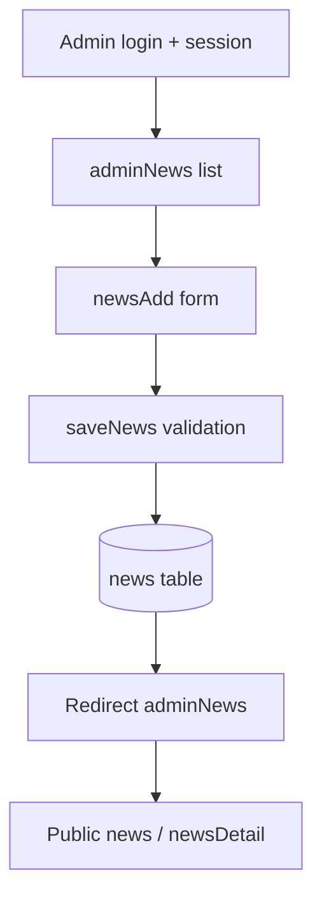

# Module-Wise Workflow Analysis

**Date:** 2026-11-04

## 1. Workflow completeness matrix

Legend: C=Create R=Read U=Update D=Deactivate/Del S=Submit X=export. **Approve/Reject/Cancel/Reopen/Draft** — not applicable in legacy CMS unless noted as gap.

| Module | Open | List/Read | Search/Filter | Create | Edit | Delete/Deactivate | Submit | Approve | Export | Notify | Audit | Completeness notes |
|--------|------|-----------|---------------|--------|------|-------------------|--------|---------|--------|--------|-------|---------------------|
| Public contact | Y | — | — | Y form | — | — | Y sendMsg | — | — | Y email | — | CAPTCHA validated |
| Job apply | Y | Y jobs | — | Y apply | — | — | Y saveCandidate | — | — | Y email | — | Resume upload |
| Admin news | Y | Y adminNews | partial table | Y newsAdd | Y editNews | Y newsDeactivate | Y save | — | — | — | — | No draft workflow (GAP-003) |
| Admin careers | Y | Y adminCareer | — | Y careerAdd | Y editJob | Y jobDeactivate | Y saveJob | — | Y resumes | — | — | jobApplications review |
| Admin gallery | Y | Y groupView | — | Y groupAdd/galleryAdd | — | Y deleteImage/deactivateGroup | Y save | — | — | — | — | |
| Admin banner | Y | Y adminBanner | — | Y bannerAdd | Y editBanner | Y bannerDeactivate | Y save | — | — | — | — | Drag order updateBannerOrder |
| Admin data sheets | Y | Y adminBlogs | — | Y blogAdd | Y editBlog | Y blogDeactivate | Y save | — | Y downloadBlogDoc | — | — | |
| Admin requests | Y | Y request/solRequest | — | — | — | — | — | — | — | — | — | Read-only lists |
| Blog comments | — | Y viewComments | — | Y saveComment | — | — | — | — | — | — | — | Moderation gap GAP-010 |
| Authentication | Y | — | — | — | — | — | Y login | — | — | — | — | Single admin GAP-001 |

## 2. End-to-end workflow — job application (existing)

## 3. End-to-end workflow — admin news publish (existing)

## 4. Target-state workflow enhancements (proposed — Category C/D)

- Editorial draft → review → publish for news and data sheets.
- Admin MFA login; role-based module access.
- In-app notification when new enquiry or job application arrives.
