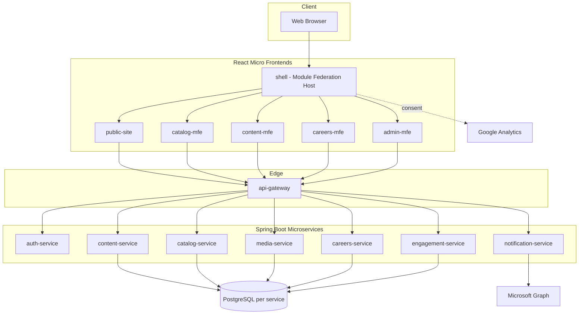
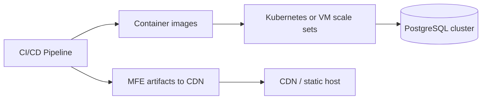

# System Architecture — Proposed Target State

**Status:** Proposed (rebuild) — not present in existing WAR.  
**Date:** 2026-11-04

## 1. Architecture overview

The rebuild adopts a **micro-frontend (MFE)** presentation tier and **Spring Boot microservices** backend, replacing the monolithic Struts/Spring/Hibernate WAR. **PostgreSQL** is the mandatory target RDBMS (database-per-microservice in production). Legacy **MariaDB** `kran_website` is the migration source only — see `Database_Requirements.md` and `postgresql/`.

## 2. Micro-frontends (Module Federation recommended)

| MFE | Responsibility |
|-----|----------------|
| shell | Host app, routing, layout, Module Federation |
| public-site | Marketing pages, solutions, services, CSR, tech |
| catalog-mfe | Projects, case studies, clients, domain |
| content-mfe | News, blog/data sheets, gallery, timeline |
| careers-mfe | Careers listing and application |
| admin-mfe | Authenticated admin console |

**Integration pattern:** Webpack Module Federation (or equivalent) exposes remote modules loaded by `shell`. Shared component library (design tokens, header/footer, cookie consent) ships as a shared package to avoid duplication.

**Routing:** Shell owns top-level routes (`/`, `/solutions/:slug`, `/admin/*`). Legacy Struts `.action` URLs redirect via gateway rules during migration.

## 3. Backend microservices

| Service | Responsibility |
|---------|----------------|
| api-gateway | Edge routing, rate limiting, JWT validation |
| auth-service | Admin authentication, session/token issuance |
| content-service | News, blog/data sheets, banners, timeline, static pages metadata |
| catalog-service | Solutions, services, project products, Kran projects/solutions |
| media-service | Gallery groups/images, file uploads |
| careers-service | Job postings, applications, resume storage |
| engagement-service | Contact/enquiry forms, comments, application requests |
| admin-service | Aggregated admin operations or BFF for admin UI |
| notification-service | Microsoft Graph email dispatch |

**Communication:** Synchronous REST for reads; async messaging (optional) for email and bulk exports. No invented services beyond this list for v1 parity.

## 4. Comparison to existing stack

| Concern | Existing (As-Is) | Proposed (To-Be) |
|---------|------------------|------------------|
| UI | JSP + Tiles + jQuery | React MFEs |
| API | Struts `.action` | REST `/api/v1/*` |
| Auth | HTTP session `userBean` | JWT / server session via auth-service |
| Deployment | Single WAR | Independent service + MFE pipelines |
| Database | MariaDB monolith `kran_website` | PostgreSQL per microservice (Flyway, HikariCP) |
| ORM | Hibernate 4 monolith | Spring Data JPA / Hibernate 6 per service |
| XSS | ESAPI filter | Gateway + framework validators |

## 5. Security architecture

- Externalize admin credentials (remediation of `LoginAction.java` hardcoding).
- CAPTCHA on login and sensitive public POST endpoints.
- OWASP ASVS L2 targets for auth and input validation.
- Secrets for Microsoft Graph in vault, not `mail_setup` plaintext fields where avoidable.

## 6. Observability

- Centralized logging with correlation IDs propagated from gateway.
- Metrics: request rate, error rate, latency per service.
- Health: Spring Boot Actuator endpoints behind gateway allow-list.

## 7. Deployment view

## 8. Migration strategy (high level)

1. Strangle legacy: expose read APIs over existing tables.
2. Stand up MFE shell with public read-only routes.
3. Move admin CRUD to admin-mfe + APIs.
4. Decommission Struts actions per route group with redirect map.
