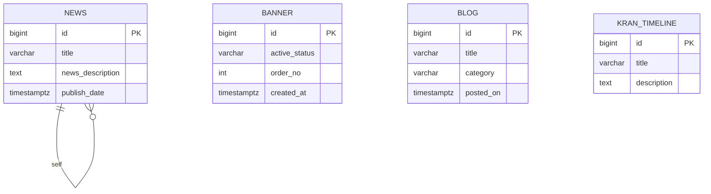
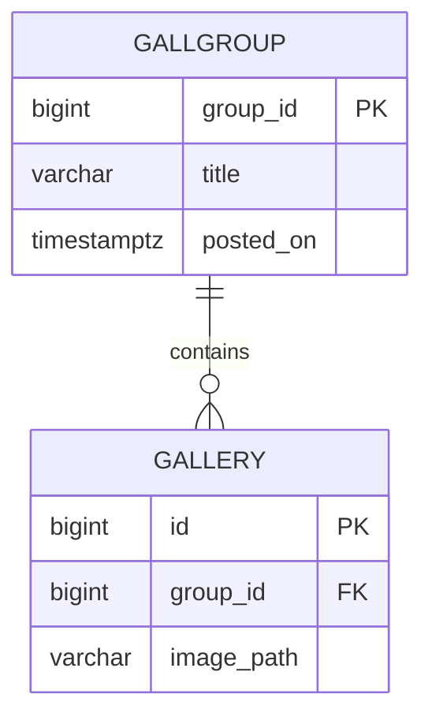
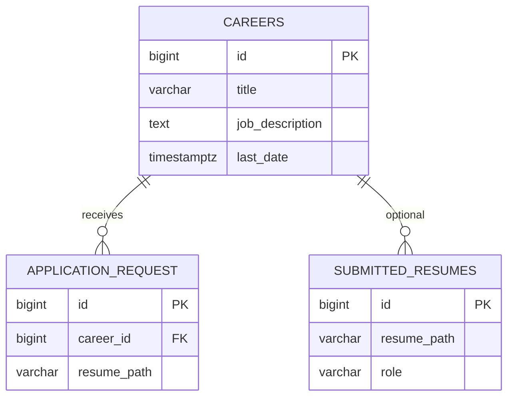
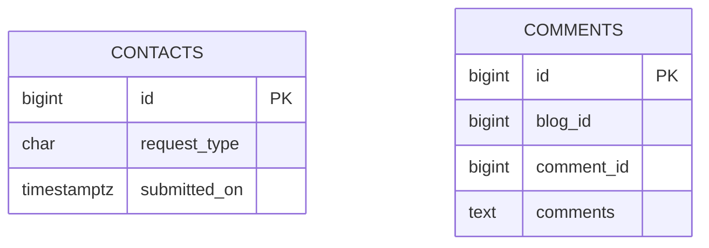
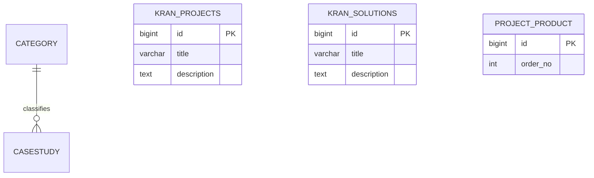

# PostgreSQL Database Architecture — KranConsulting Rebuild

**Status:** Mandatory target architecture (proposed)  
**Date:** 2026-11-04  
**Existing system:** MariaDB/MySQL schema `kran_website` (Hibernate 4, single monolith) — **not PostgreSQL**

---

## 1. Technology stack (target)

| Component | Selection |
|-----------|-----------|
| RDBMS | **PostgreSQL** 15+ (LTS track) |
| ORM | Spring Data JPA / Hibernate 6.x |
| Migrations | **Flyway** (preferred) or Liquibase |
| Connectivity | Spring `DataSource`, JDBC |
| Pooling | **HikariCP** (per service) |
| Time types | `TIMESTAMPTZ` for business timestamps (Asia/Kolkata app layer) |
| Money | `NUMERIC(p,s)` — not used in current legacy CMS tables |
| Primary keys | `BIGINT GENERATED BY DEFAULT AS IDENTITY`; preserve migrated legacy `id` values |

---

## 2. Architecture decision: database-per-service vs schema-per-service

### Options evaluated

| Criterion | Separate PostgreSQL **database** per microservice | Separate **schema** per microservice (one PostgreSQL cluster) |
|-----------|---------------------------------------------------|----------------------------------------------------------------|
| Data isolation | Strong; no accidental cross-join | Good with role `search_path` + REVOKE |
| Blast radius | Instance failure affects one DB if clustered per DB | Shared instance failure affects all |
| Connection pools | Independent Hikari pools per service | Shared instance, separate pools per schema |
| Flyway | One migration history per database | One Flyway history per schema (custom locations) |
| Ops complexity | Higher (more DBs to backup/monitor) | Lower for small teams |
| Cross-service FK | **Prohibited** (by design) | **Prohibited** across schemas |
| Scale-out | Aligns with independent service scaling | Vertical scale first |

### Recommendation

| Environment | Approach |
|-------------|----------|
| **Production** | **Separate PostgreSQL database per microservice** on a managed cluster (e.g. RDS/Aurora, Azure Flexible Server, or self-hosted Patroni). |
| **Development / CI** | Single PostgreSQL instance with **one schema per service** mirroring production ownership rules (same table names forbidden across schemas except read replicas). |

**Architecture rule:** No microservice may obtain JDBC credentials or JPA mappings for another service’s tables. Cross-domain references use **logical IDs** (`BIGINT` or `UUID`) without cross-database foreign keys. Referential integrity across boundaries is enforced via APIs, events, or eventual consistency.

---

## 3. Service-to-database mapping

| Microservice | PostgreSQL database (prod) | Schema (dev) | Legacy MariaDB tables |
|--------------|----------------------------|--------------|------------------------|
| auth-service | `kran_auth` | `auth` | *(none — legacy admin was hardcoded)* |
| content-service | `kran_content` | `content` | `news`, `banner`, `blog`, `kran_timeline` |
| catalog-service | `kran_catalog` | `catalog` | `category`, `casestudy`, `kran_projects`, `kran_solutions`, `kran_faces`, `kran_seniors`, `project_product` |
| media-service | `kran_media` | `media` | `gallgroup`, `gallery` |
| careers-service | `kran_careers` | `careers` | `careers`, `application_request`, `submitted_resumes` |
| engagement-service | `kran_engagement` | `engagement` | `contacts`, `comments` |
| notification-service | `kran_notification` | `notification` | `mail_setup` (+ new `outbound_email_log`) |

---

## 4. Cross-service references (logical, not FK)

| From table | Column | References (logical) | Resolution |
|------------|--------|----------------------|------------|
| `comments` | `blog_id` | content-service `blog.id` | Validate via content API or cached id registry |
| `application_request` | `career_id` | careers-service `careers.id` | FK **within** `kran_careers` only |
| `gallery` | `group_id` | media-service `gallgroup.group_id` | FK **within** `kran_media` only |
| Enquiry payloads | `product_name` | catalog/content | Denormalized snapshot at submit time |

---

## 5. Normalization and legacy denormalization

- Legacy `blog.category` and `casestudy.category` store **string** category names; target model adds optional `category_id BIGINT` referencing `catalog.category` via API-synchronized id, retaining `category_label` for legacy parity during migration.
- Legacy `active_Status` / `active_status` char flags map to `VARCHAR(1)` (`Y`/`N`) plus optional `is_active BOOLEAN GENERATED` or application mapping — migration script converts consistently.
- `kran_projects` service flag columns (`service_con`, etc.) remain columns (wide table) in v1 for parity; v2 may normalize to `kran_project_service` child table (Requires Business Confirmation).

---

## 6. Audit and soft delete

All admin-managed entities include:

| Column | Type | Purpose |
|--------|------|---------|
| `created_at` | `TIMESTAMPTZ NOT NULL DEFAULT now()` | Row creation |
| `created_by` | `VARCHAR(128)` | Admin user id or subject from JWT |
| `updated_at` | `TIMESTAMPTZ NOT NULL DEFAULT now()` | Last mutation |
| `updated_by` | `VARCHAR(128)` | Last editor |
| `deleted_at` | `TIMESTAMPTZ NULL` | Soft delete when business requires retain history |
| `deleted_by` | `VARCHAR(128) NULL` | Soft delete actor |

**Soft delete applies to:** `news`, `blog`, `banner`, `casestudy`, `careers`, `kran_*` catalog rows, `gallgroup`, `gallery`, `project_product`, `category`, `mail_setup`.  
**Hard retain + archive:** `contacts`, `application_request`, `submitted_resumes` (compliance); soft delete via `archived_at` instead of physical delete.

Public queries default: `WHERE deleted_at IS NULL AND is_active = true` (or legacy `active_status = 'Y'`).

---

## 7. Transaction management

| Pattern | Usage |
|---------|--------|
| Local `@Transactional` | Single-service create/update (e.g. gallery group + images in media-service) |
| Outbox table (optional) | notification-service email dispatch after enquiry commit |
| Saga / compensation | Not required for v1 CMS parity; document if order workflows added |
| Read-only transactions | All public list/detail repository methods |
| Isolation | Default `READ COMMITTED`; optimistic locking via `@Version BIGINT` on contested admin entities |

---

## 8. Pagination and sorting

- API: `page` (0-based), `size` (default 20, max 100), `sort=field,asc|desc`.
- PostgreSQL: `ORDER BY` on indexed columns; **keyset pagination** (`WHERE id > :cursor ORDER BY id LIMIT :n`) for large admin lists.
- Avoid `OFFSET` for deep pages on high-volume tables (`contacts`, `comments`).

---

## 9. Indexing strategy (summary)

- PK clustered on `id` (default heap).
- Partial indexes: `CREATE INDEX ... ON news (posted_on DESC) WHERE deleted_at IS NULL AND active_status = 'Y';`
- FK columns: `gallery(group_id)`, `application_request(career_id)`, `comments(blog_id)`.
- Search: PostgreSQL `GIN` on `to_tsvector('english', title || ' ' || coalesce(body,''))` for news/blog/casestudy — or external OpenSearch (see Open Questions OQ-005).

---

## 10. ER diagrams (per bounded context)

### 10.1 Content service (`kran_content`)



### 10.2 Media service (`kran_media`)



### 10.3 Careers service (`kran_careers`)



### 10.4 Engagement service (`kran_engagement`)



### 10.5 Catalog service (`kran_catalog`)



---

## 11. Deliverable index

| Document | Path |
|----------|------|
| Data dictionary | `postgresql/Data_Dictionary.md` |
| Table relationships | `postgresql/Table_Relationships.md` |
| Flyway DDL scripts | `postgresql/ddl/*/V001__baseline.sql` |
| MariaDB → PostgreSQL migration | `postgresql/Migration_Strategy_MariaDB_to_PostgreSQL.md` |
| Security | `postgresql/Security_Requirements.md` |
| Performance & backup | `postgresql/Performance_Backup_Requirements.md` |

---

## 12. Connection configuration (per service)

```yaml
# Example Spring Boot 3 — content-service
spring:
  datasource:
    url: jdbc:postgresql://${PG_HOST}:5432/kran_content?sslmode=require
    username: ${KRAN_CONTENT_DB_USER}
    password: ${KRAN_CONTENT_DB_PASSWORD}
    hikari:
      maximum-pool-size: 20
      minimum-idle: 5
      connection-timeout: 30000
  jpa:
    hibernate:
      ddl-auto: validate
    properties:
      hibernate.jdbc.time_zone: Asia/Kolkata
  flyway:
    enabled: true
    locations: classpath:db/migration
```

**Rule:** `ddl-auto` never `update` in production; schema changes only via Flyway.
