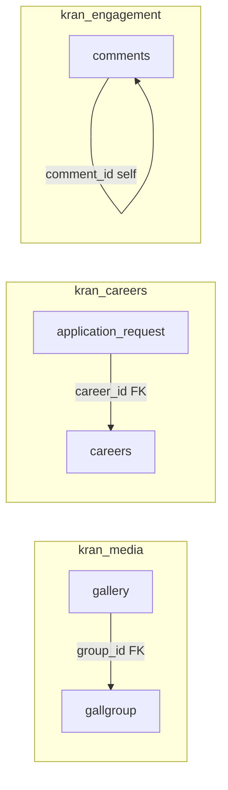

# Table Relationship Documentation

**Database:** PostgreSQL (target)  
**Rule:** Foreign keys exist **only within a single microservice database**.

---

## Intra-service relationships

| Child table | Column | Parent table | Parent column | Service | On delete |
|-------------|--------|--------------|---------------|---------|-----------|
| gallery | group_id | gallgroup | group_id | media | RESTRICT |
| application_request | career_id | careers | id | careers | RESTRICT |
| comments | comment_id | comments | id | engagement | SET NULL (self-ref thread) |

---

## Logical cross-service references (no FK)

| Table (service) | Column | Referenced entity (service) | Enforcement |
|-----------------|--------|----------------------------|-------------|
| comments (engagement) | blog_id | blog (content) | API validation on create; optional async cache of valid blog ids |
| contacts (engagement) | product_name | project_product / kran_projects (catalog) | Denormalized text only |
| Public URLs | `/newsDetail?id=` | news.id (content) | Stable numeric ids preserved in migration |

---

## Legacy MariaDB relationships (as-is)

From Hibernate and `db_dump/db ater.txt`:

| Relationship | Status in MariaDB |
|--------------|-------------------|
| gallery.group_id → gallgroup.group_Id | FK `fk_gallery_1` documented in dump |
| application_request.career_Id → careers.id | Hibernate `@ManyToOne` |
| comments.blog_Id → blog.id | Application-level only (no FK in dump) |
| category → casestudy/blog | String match on category name, not FK |

---

## Relationship diagram (physical FKs only)

---

## Cardinality notes

| Pair | Cardinality | Business rule |
|------|-------------|---------------|
| gallgroup : gallery | 1:N | One album, many images; deactivate group hides children in UI |
| careers : application_request | 1:N | Multiple applicants per job posting |
| blog : comments | 1:N | Thread via comment_id null = root comment |
| careers : submitted_resumes | 0:N | General pool applications not tied to career_id |

---

## Orphan prevention

| Scenario | Handling |
|----------|----------|
| Delete blog in content-service | engagement-service marks comments orphaned or hides via `blog_id` stale check job |
| Deactivate career | careers-service rejects new applications; existing applications retained |
| Delete gallery group | RESTRICT until images removed or cascade soft-delete children |
